# Guida di BIMit

BIMit assegna la **WBS** agli elementi dei modelli Autodesk Revit (2022, 2023, 2024, 2025, 2026),
esporta tavole e viste in PDF, DWG, DGN, DWF, NWC, IFC e immagini e aggiunge strumenti per i parametri, per il modello
e per gli impianti MEP.
Questa guida mostra ogni finestra e spiega ogni pulsante, nell'ordine in cui li usi.

> Le immagini sono fatte sul modello di esempio di Autodesk *Snowdon Towers Sample HVAC*. Nel tuo
> Revit i nomi delle categorie compaiono nella lingua di Revit (per esempio *Terminali d'aria*
> invece di *Air Terminals*).

## Indice

1. [Installare, aggiornare, disinstallare](#1-installare-aggiornare-disinstallare)
2. [Account: accesso e registrazione](#2-account-accesso-e-registrazione)
3. [La scheda BIMit in Revit](#3-la-scheda-bimit-in-revit)
4. [L'intestazione delle finestre](#4-lintestazione-delle-finestre)
5. [La finestra WBS](#5-la-finestra-wbs)
6. [Configurare i parametri](#6-configurare-i-parametri)
7. [Gli stati: completo, da rivedere, incompleto](#7-gli-stati-completo-da-rivedere-incompleto)
8. [Anteprima](#8-anteprima)
9. [Scrivi nel modello](#9-scrivi-nel-modello)
10. [Il dizionario Excel](#10-il-dizionario-excel)
11. [Esporta tavole e viste](#11-esporta-tavole-e-viste)
12. [Parametri: aggiungi, gestisci, pulisci le famiglie](#12-parametri-aggiungi-gestisci-pulisci-le-famiglie)
13. [Modello: sblocca, sposta livello, esporta per IA](#13-modello-sblocca-sposta-livello-esporta-per-ia)
14. [MEP: manicotti, locali → spazi](#14-mep-manicotti-locali--spazi)
15. [Claude (MCP)](#15-claude-mcp)
16. [Account, Feedback, Aggiornamento](#16-account-feedback-aggiornamento)
17. [Domande frequenti](#17-domande-frequenti)

**Il flusso in breve:** apri *WBS* → scegli *WBS normativa* (o *Manuale*) → controlla le categorie →
correggi quello che serve in *Configura* → *Anteprima* → *Scrivi nel modello*.

---

## 1. Installare, aggiornare, disinstallare

**Installare**

1. Chiudi Revit.
2. Scarica `BIMit_Setup_<versione>.msi` dall'ultima [release](../../releases/latest).
3. Aprilo con doppio clic. **Non servono permessi di amministratore**: BIMit si installa solo per il
   tuo utente, in tutte le versioni di Revit 2022–2026 presenti sul PC.
4. Apri Revit: trovi la scheda **BIMit**.

Se Windows mostra l'avviso SmartScreen: *Ulteriori informazioni* → *Esegui comunque*.

**Aggiornare** — non devi fare niente. All'avvio di Revit BIMit controlla se c'è una nuova versione,
la scarica da solo e la installa **quando chiudi Revit**, senza finestre e senza permessi di
amministratore. La volta dopo, al primo comando, un messaggio ti dice *BIMit è stato aggiornato* e
cosa è cambiato. Nuovi pulsanti e funzioni arrivano così, da soli.

Alcuni aggiornamenti sono **obbligatori**: BIMit te lo dice al primo comando e, se serve, ti fa
scaricare la nuova versione con un clic. I comandi ripartono dopo che hai chiuso e riaperto Revit.

**Disinstallare** — *Impostazioni di Windows* → *App* → *App installate* → **BIMit** →
*Disinstalla*. I parametri già scritti nei modelli restano.

---

## 2. Account: accesso e registrazione

Per usare BIMit serve un account personale (gratuito durante la beta). La finestra compare da sola
la prima volta che usi un comando, oppure con il pulsante **Account** della scheda BIMit.

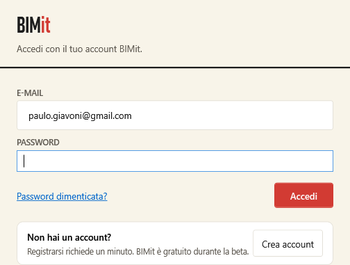

| Elemento | Cosa fa |
|---|---|
| **E-MAIL**, **PASSWORD** | Le credenziali del tuo account BIMit. |
| **Password dimenticata?** | Ti manda un'e-mail per sceglierne una nuova. Scrivi prima l'e-mail nel campo sopra. |
| **Accedi** | Entra. L'accesso resta valido anche offline fino a 30 giorni. |
| **Crea account** | Apre il modulo di registrazione (sotto). |

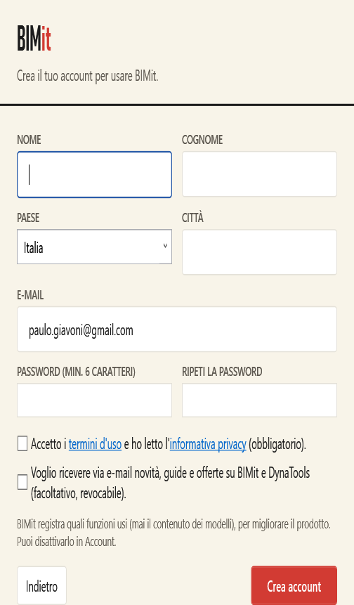

| Campo | Note |
|---|---|
| **NOME**, **COGNOME**, **PAESE**, **CITTÀ** | Obbligatori. |
| **E-MAIL** | Sarà il tuo nome utente. |
| **PASSWORD (MIN. 6 CARATTERI)**, **RIPETI LA PASSWORD** | Devono coincidere. |
| **Accetto i termini d'uso e ho letto l'informativa privacy** | Obbligatorio. I link aprono i testi. |
| **Voglio ricevere via e-mail novità…** | Facoltativo; lo cambi quando vuoi in *Account*. |
| **Indietro** | Torna all'accesso. |
| **Crea account** | Crea l'account ed entra. |

Se hai già un account ma manca il profilo, BIMit ti chiede solo i dati mancanti (pulsante **Continua**).

---

## 3. La scheda BIMit in Revit

| Pulsante | Cosa fa |
|---|---|
|  **WBS** | Apre la [finestra WBS](#5-la-finestra-wbs): configurazione, anteprima, scrittura. |
|  **Anteprima** | Apre subito l'[anteprima](#8-anteprima) con la configurazione collegata al modello. **Shift + clic**: solo gli elementi della vista attiva. |
|  **Esporta** | Tavole e viste in PDF, DWG, DGN, DWF, NWC, IFC, immagini e dati, con profili, coda, report ed esportazioni pianificate ([Esporta](#11-esporta-tavole-e-viste)). |
|  **Aggiungi parametri** | Parametri di un file di parametri condivisi su tutte le categorie che scegli ([Aggiungi parametri](#aggiungi-parametri)). |
|  **Gestione parametri** | Tutti i parametri di progetto: dove sono assegnati, quanti valori hanno, elimina quelli inutili ([Gestione parametri](#gestione-parametri)). |
|  **Parametri famiglie** | Toglie dalle famiglie caricate i parametri che non servono ([Parametri famiglie](#parametri-famiglie)). |
|  **Sblocca tutto** | Sblocca gli elementi bloccati, categoria per categoria ([Sblocca tutto](#sblocca-tutto)). |
|  **Sposta livello** | Porta un livello a una nuova quota con tutto quello che dipende da lui ([Sposta livello](#sposta-livello)). |
|  **Esporta per IA** | Il modello in tabelle CSV con un indice, da dare a un assistente IA ([Esporta per IA](#esporta-per-ia)). |
|  **Manicotti** | Manicotti o forometrie dove gli impianti attraversano muri, solai e altro ([Manicotti](#manicotti)). |
|  **Locali → spazi** | Linee di separazione spazi dal contorno dei locali di un modello collegato ([Locali → spazi](#locali--spazi)). |
|  **MCP On / Off** | Accende (verde) o spegne (rosso) il server MCP: Claude usa tutti gli strumenti di BIMit, con il tuo account, anche su più Revit aperti insieme ([Claude (MCP)](#15-claude-mcp)). |
|  **Config MCP** | Copia il prompt che collega Claude a BIMit e apre la finestra di configurazione ([Claude (MCP)](#15-claude-mcp)). |
|  **Account** | Accesso, profilo, privacy, aggiornamenti ([Account](#account)). |

*Anteprima* funziona solo dopo che hai salvato una configurazione per il modello dalla finestra WBS.

---

## 4. L'intestazione delle finestre

In alto in ogni finestra:

| Elemento | Cosa fa |
|---|---|
| **BIMit · titolo** | Il nome della finestra; sotto, il modello o la configurazione. Il pallino **•** dopo il nome vuol dire *modifiche non salvate*. |
| **v0.5.0** | La versione installata. |
| **Aggiorna a … / Aggiornamento pronto** | Compare solo quando c'è una nuova versione. *Aggiornamento pronto*: è già scaricata e si installa quando chiudi Revit. Apre la finestra [Aggiornamento](#aggiornamento). |
| **Guida** | Apre questa guida. |
| **Feedback** | Scrivi un problema o un'idea ([Feedback](#feedback)). |
| **BETA** | Il tuo piano. *ACCEDI* se non hai fatto l'accesso. |
| **Cerchio con le iniziali** | Apre l'*Account* (o l'accesso). |

---

## 5. La finestra WBS

La finestra principale. Si apre con il pulsante **WBS**.

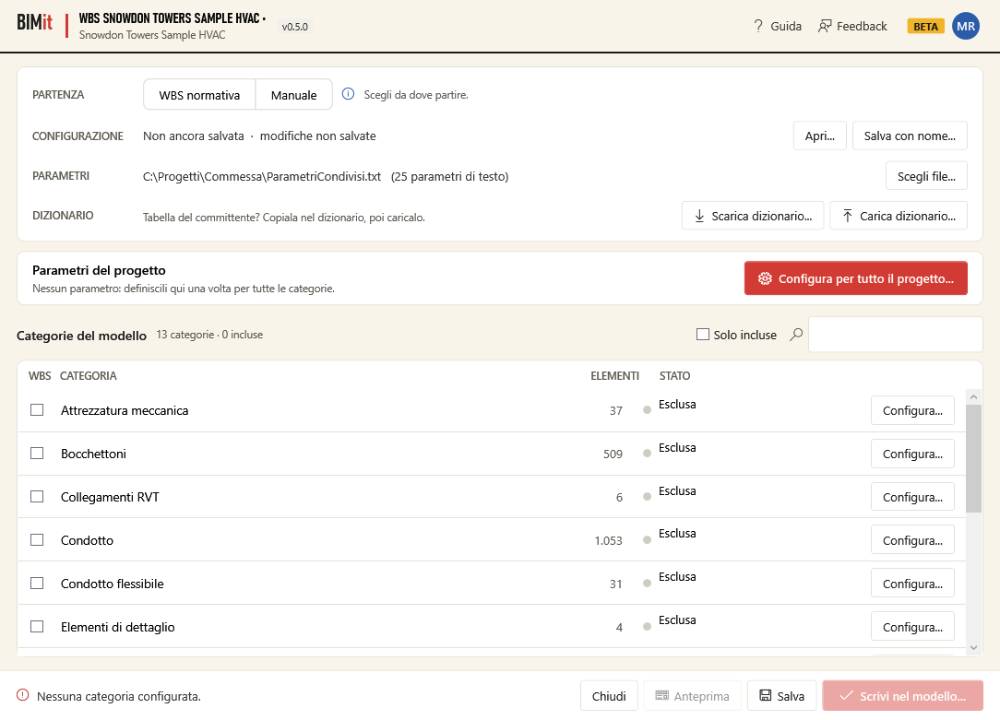

### Riquadro in alto

| Riga / pulsante | Cosa fa |
|---|---|
| **PARTENZA · WBS normativa** | Carica la WBS normativa già pronta: parametri, codici, regole e categorie. Il codice ha la forma `PROGETTO-ZONA-LIVELLO-DISCIPLINA-SISTEMA-ELEMENTO`. Poi cambi solo quello che serve. |
| **PARTENZA · Manuale** | Parti da zero e definisci tu i parametri. Svuota la configurazione attuale (BIMit chiede conferma). |
| **ⓘ** | Passa il mouse: la norma di riferimento e una spiegazione della WBS normativa. |
| **CONFIGURAZIONE** | Il file della configurazione (`.json`) e se ci sono *modifiche non salvate*. BIMit lo collega al modello: la prossima volta si riapre da solo. |
| **Apri…** | Apre un'altra configurazione, per esempio quella di un collega o di un altro progetto. |
| **Salva con nome…** | Salva la configurazione in un nuovo file. |
| **PARAMETRI** | Il file dei parametri condivisi (`.txt`) da cui scegli i nomi dei parametri. BIMit lo **legge soltanto**. Senza file, i parametri nuovi li crea BIMit con un suo file. |
| **Scegli file…** | Sceglie il file dei parametri condivisi. |
| **DIZIONARIO · Scarica dizionario…** | Salva la WBS in un foglio Excel da compilare con i codici del committente ([dizionario](#10-il-dizionario-excel)). |
| **DIZIONARIO · Carica dizionario…** | Legge il foglio compilato e aggiorna codici e struttura. |

Con la **WBS normativa** la finestra si riempie:

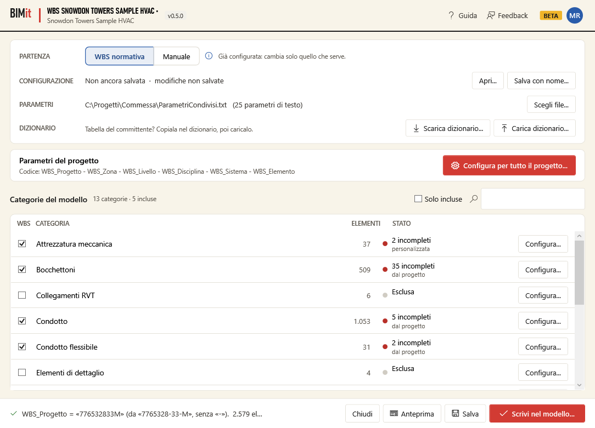

### Parametri del progetto

La riga *Codice: WBS_Progetto - WBS_Zona - …* riassume come si forma il codice.
**Configura per tutto il progetto…** apre la [configurazione dei parametri](#6-configurare-i-parametri)
che valgono per **tutte** le categorie incluse: li definisci una volta sola.

> Se il numero di progetto contiene il separatore del codice (per esempio `7765328-33-M` con `-`),
> caricando la WBS normativa BIMit lo usa senza separatore (`776532833M`) come testo fisso e te lo
> scrive in basso. Puoi cambiarlo in *Configura per tutto il progetto* → `WBS_Progetto`.

### Categorie del modello

Tutte le categorie che hanno elementi nel modello, con quanti sono.

| Colonna / pulsante | Cosa fa |
|---|---|
| **WBS** (casella) | Includi o escludi la categoria. Solo le categorie incluse ricevono la WBS. |
| **CATEGORIA**, **ELEMENTI** | Nome (nella lingua di Revit) e numero di elementi. |
| **STATO** | *Esclusa*, *Da configurare*, *Pronta*, oppure quanti elementi sono *incompleti* o *da rivedere*. Sotto: *dal progetto* (usa i parametri del progetto) o *personalizzata* (ha modifiche proprie). |
| **Configura…** | Apre la configurazione di quella categoria (anche con doppio clic sulla riga). Se la categoria era esclusa, la include. |
| **Solo incluse** | Mostra solo le categorie incluse. |
| **🔍 casella di ricerca** | Filtra le categorie per nome. |

### Piede della finestra

| Elemento | Cosa fa |
|---|---|
| **Messaggio a sinistra** | ✔ quanti elementi hanno il codice completo, oppure ⚠ il primo errore della configurazione (passa il mouse per vederli tutti). |
| **Chiudi** | Chiude. Se ci sono modifiche non salvate chiede se salvarle. |
| **Anteprima** | Calcola il codice di tutti gli elementi e apre l'[anteprima](#8-anteprima). Disattivato finché la configurazione ha errori o nessuna categoria. |
| **Salva** | Salva la configurazione (anche **Ctrl+S**). La prima volta la mette in `Documenti\BIMit\<modello>_WBS.json`. |
| **Scrivi nel modello…** | Salva la configurazione e apre il [riepilogo prima di scrivere](#9-scrivi-nel-modello). Disattivato se il modello è di sola lettura. |

---

## 6. Configurare i parametri

La stessa finestra serve per **tutto il progetto** (*Configura per tutto il progetto…*) e per **una
categoria** (*Configura…*). Nella categoria parti dai parametri del progetto e cambi solo quello
che serve a lei.

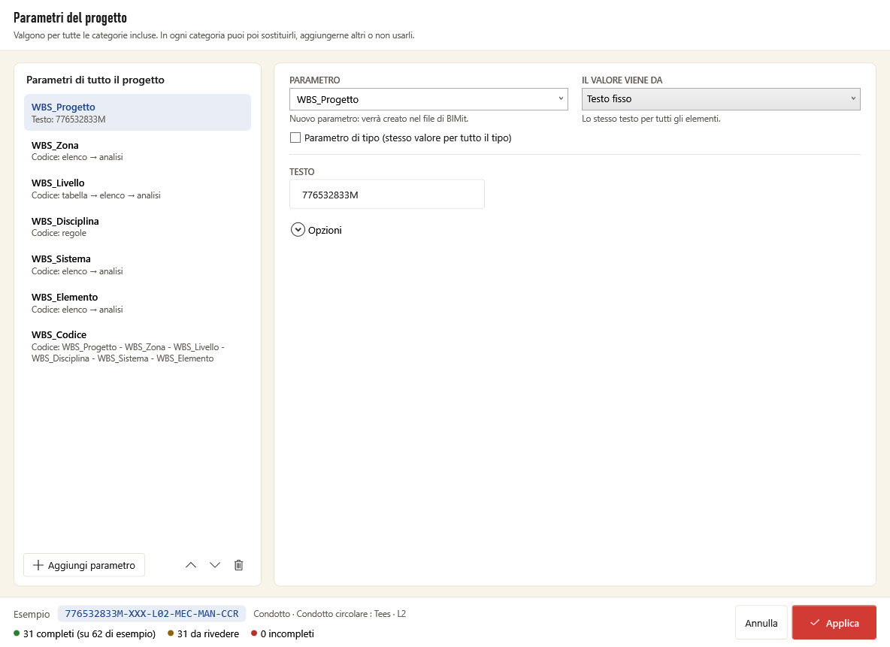

### Colonna di sinistra: i parametri da compilare

| Elemento | Cosa fa |
|---|---|
| **Elenco** | Un parametro per riga, con il riassunto di da dove viene il valore. In una categoria: *dal progetto*, *modificato qui* o *solo qui*. |
| **Aggiungi parametro** | Aggiunge un parametro nuovo. |
| **↑ ↓** | Cambiano l'ordine. |
| **🗑** | Nel progetto: toglie il parametro. In una categoria: *non usarlo qui* (le altre categorie lo usano ancora). |
| **Non usati qui · Riusa** | Solo in una categoria: i parametri del progetto che hai tolto; **Riusa** li rimette. |

### A destra: il parametro scelto

| Elemento | Cosa fa |
|---|---|
| **Banner giallo** | In una categoria: *Modificato in questa categoria* o *Parametro usato solo in questa categoria*. **Ripristina dal progetto** annulla le modifiche e torna alla versione del progetto. |
| **PARAMETRO** | Il nome del parametro da compilare: dal file dei parametri condivisi, dai parametri già nel progetto, oppure scrivi un nome nuovo (lo crea BIMit). |
| **IL VALORE VIENE DA** | La fonte del valore (sotto). |
| **Parametro di tipo** | Spuntato: un valore uguale per tutti gli elementi dello stesso tipo. Non spuntato: un valore per ogni elemento (istanza). |

**Le cinque fonti del valore**

| Fonte | Cosa scrive | Cosa scegli |
|---|---|---|
| **Testo fisso** | Lo stesso testo per tutti gli elementi. | **TESTO**. |
| **Informazioni progetto** | Un campo di *Gestisci → Informazioni progetto*. | **CAMPO**: numero, nome, cliente, edificio, organizzazione, indirizzo, stato, autore (vedi accanto il valore del modello). |
| **Proprietà dell'elemento** | Il valore di una proprietà, così com'è. | **PROPRIETÀ**: nome famiglia, nome tipo, descrizione, livello, sistema, commenti, contrassegno, workset, fase… oppure **Altro parametro…** e scrivi il nome di un parametro qualsiasi. |
| **Codice (regole, tabella, analisi)** | Un codice scelto da un elenco con regole, tabella e analisi. | Vedi sotto. |
| **Combina parametri** | Il **codice WBS completo**, unendo gli altri parametri. | Vedi sotto. |

### La fonte «Codice»

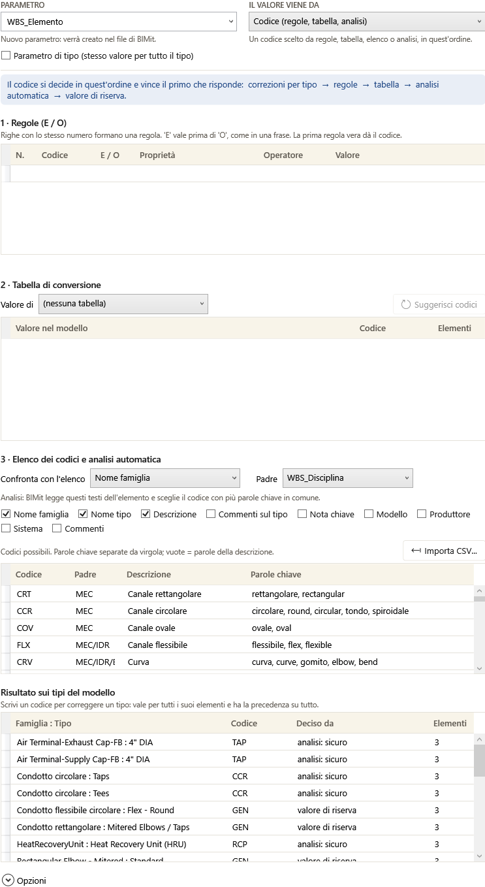

Il codice si decide in quest'ordine e **vince il primo che risponde**:
**correzioni per tipo → regole → tabella → elenco e analisi → valore di riserva**.

**1 · Regole (E / O)** — condizioni scritte da te.

| Colonna | Significato |
|---|---|
| **N.** | Il numero della regola: le righe con lo stesso numero formano **una** regola. |
| **Codice** | Il codice che la regola assegna (sulla prima riga della regola). |
| **E / O** | Come la riga si lega alla precedente. *E* vale prima di *O*, come in una frase. |
| **Proprietà** | Cosa leggere sull'elemento (categoria, nome famiglia, classificazione del sistema…). |
| **Operatore** | *contiene, uguale a, inizia con, finisce con, non contiene, diverso da, è vuoto, non è vuoto*. |
| **Valore** | Il testo da confrontare (maiuscole e accenti non contano). |

Sotto la tabella BIMit rilegge ogni regola in italiano (*Regola 1: se … → ANT*): controlla lì che
dica quello che intendi. Aggiungi una riga scrivendo nell'ultima riga vuota; per toglierla clicca il
bordino a sinistra della riga e premi **Canc** (vale per tutte le tabelle di questa finestra).

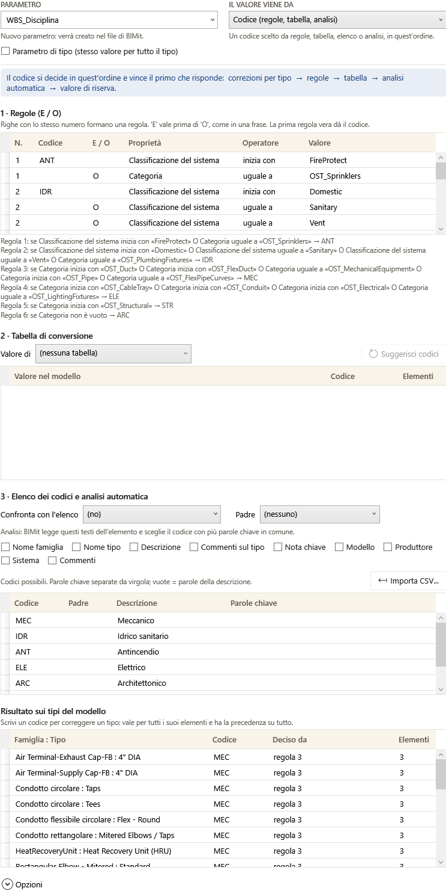

**2 · Tabella di conversione** — valore del modello → codice.

| Elemento | Cosa fa |
|---|---|
| **Valore di** | La proprietà da convertire (per esempio *Livello*). *(nessuna tabella)* = non usata. |
| **Valore nel modello** | I valori trovati negli elementi, con quanti elementi hanno quel valore (**Elementi**). |
| **Codice** | Scrivi il codice per ogni valore. |
| **Suggerisci codici** | Propone un codice per i valori senza codice (per i livelli: *Piano terra* → L00, *L2* → L02, *Copertura* → L99…). Controllali. |

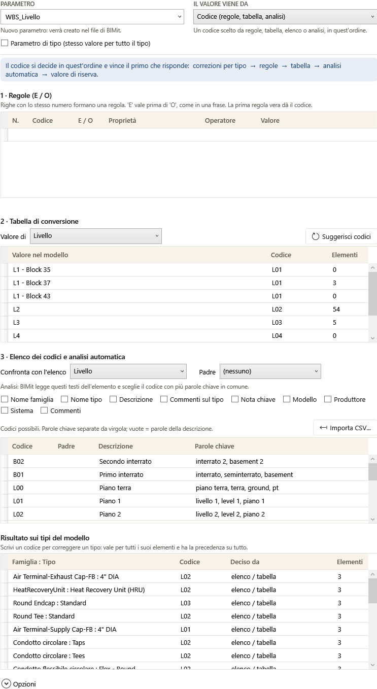

**3 · Elenco dei codici e analisi automatica** — i codici possibili e come riconoscerli.

| Elemento | Cosa fa |
|---|---|
| **Confronta con l'elenco** | Se il valore di questa proprietà è uguale a un codice o a una descrizione dell'elenco, vale quel codice. *(no)* = non confrontare. |
| **Padre** | Il codice si sceglie solo tra le righe del codice padre deciso per lo stesso elemento (per esempio l'*Elemento* tra quelli della *Disciplina*). |
| **Caselle dell'analisi** | I testi dell'elemento che BIMit legge (nome famiglia, nome tipo, descrizione, commenti, sistema…). Sceglie il codice con più **parole chiave** in comune. |
| **Importa CSV…** | Carica i codici da un file `.csv` o `.xlsx` con le colonne *codice; descrizione; parole chiave*. Chiede se sostituire o aggiungere. |
| **Tabella dei codici** | **Codice**, **Padre** (uno o più, separati da `/`), **Descrizione**, **Parole chiave** separate da virgola (vuote = le parole della descrizione). |

**Risultato sui tipi del modello** — l'esito per ogni *Famiglia : Tipo*.

| Colonna | Significato |
|---|---|
| **Famiglia : Tipo**, **Elementi** | Il tipo e quanti elementi ha. |
| **Codice** | Il codice deciso. **Scrivine uno per correggere il tipo**: vale per tutti i suoi elementi e vince su tutto il resto. |
| **Deciso da** | *regola N*, *elenco / tabella*, *analisi: sicuro*, *analisi: incerto, da rivedere*, *valore di riserva*, *deciso da te*, *nessun metodo ha risposto*… |

### La fonte «Combina parametri»

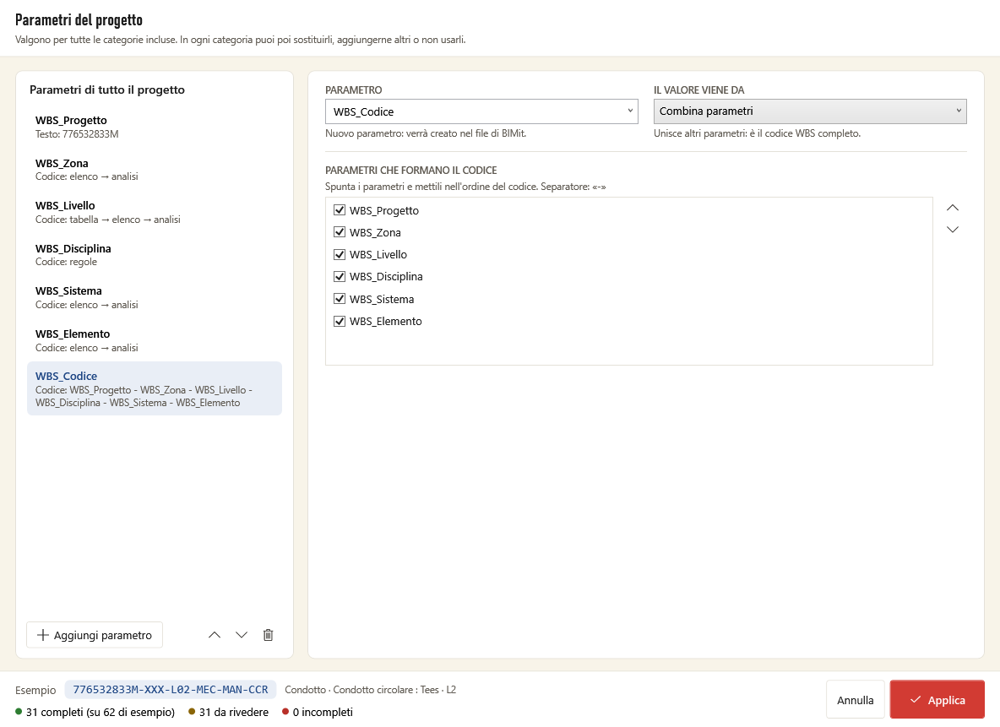

Spunta i parametri che formano il codice e mettili in ordine con **↑ ↓**. Il separatore è indicato
sopra l'elenco. Ci può essere un solo parametro *Combina parametri*.

### Opzioni

| Opzione | Cosa fa |
|---|---|
| **Obbligatorio** | Se il valore manca l'elemento resta *incompleto* (non viene scritto). Togli la spunta per i parametri facoltativi. |
| **Valore di riserva** | Il codice da usare quando nulla decide. L'elemento va in *da rivedere*. |

### Piede della finestra

| Elemento | Cosa fa |
|---|---|
| **Esempio** | Il codice di un elemento vero del modello, calcolato mentre modifichi. |
| **completi / da rivedere / incompleti** | I conteggi (nel progetto, su un campione di elementi). |
| **Problema più frequente** | In rosso: cosa blocca più elementi. |
| **Annulla** | Chiude senza applicare (chiede conferma se hai cambiato qualcosa). |
| **Applica** | Applica le modifiche alla configurazione (poi ricordati di **Salva**). Se c'è un errore te lo dice; gli avvisi puoi accettarli. |

Una categoria parte dai parametri del progetto:

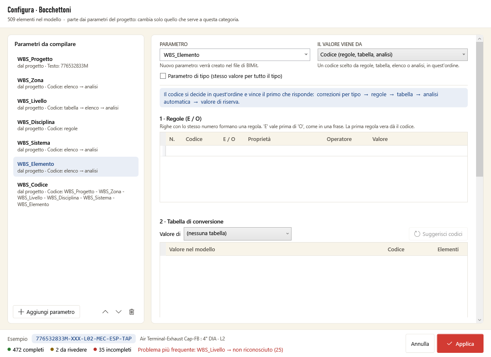

---

## 7. Gli stati: completo, da rivedere, incompleto

| Stato | Significato | Si scrive? |
|---|---|---|
| **completo** | Tutti i parametri hanno un valore deciso. | Sì |
| **da rivedere** | Il codice c'è, ma viene dal *valore di riserva* o da un'analisi incerta. Controllalo. | Sì |
| **incompleto** | Manca un valore obbligatorio o un valore non è valido. | No |
| **Esclusa** | La categoria non è inclusa nella WBS. | No |

Problemi che rendono un elemento *incompleto*:

| Problema | Cosa fare |
|---|---|
| **valore mancante** | La proprietà o il campo letto è vuoto nel modello: compilalo in Revit o cambia la fonte. |
| **valore non in tabella** | Aggiungi il valore alla *Tabella di conversione*. |
| **non riconosciuto** | Nessun metodo ha trovato il codice: aggiungi una regola, una parola chiave o una correzione per tipo. |
| **più codici possibili** | L'analisi è in pari merito: aggiungi parole chiave più precise o una regola. |
| **contiene il separatore** | Il valore contiene il separatore del codice (es. `-`): usa un altro valore o un testo fisso. |

---

## 8. Anteprima

Il codice di ogni elemento, da dove viene ogni parte, cosa correggere. Si apre dalla finestra WBS
o dalla scheda BIMit (*Shift + clic*: solo la vista attiva).

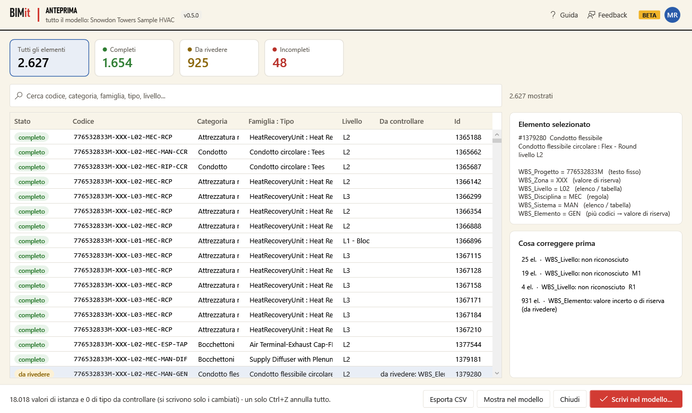

| Elemento | Cosa fa |
|---|---|
| **Carte in alto** | *Tutti gli elementi*, *Completi*, *Da rivedere*, *Incompleti*: clicca una carta per filtrare la tabella. |
| **Cerca** | Filtra per codice, categoria, famiglia, tipo, livello… |
| **Tabella** | *Stato*, *Codice*, *Categoria*, *Famiglia : Tipo*, *Livello*, *Da controllare* (i problemi), *Id*. Clicca un'intestazione per ordinare. |
| **Elemento selezionato** | Per la riga scelta: ogni parametro con il suo valore e **da dove viene** (*testo fisso*, *regola*, *elenco / tabella*, *analisi (sicuro)*, *analisi (incerto)*, *valore di riserva*, *deciso da te*, *non riuscito*…) e i problemi (✖). |
| **Cosa correggere prima** | I problemi ordinati per numero di elementi: parti dal primo. |
| **Esporta CSV** | Salva tutte le righe in un CSV da aprire in Excel. |
| **Mostra nel modello** | Chiude e seleziona in Revit gli elementi scelti (più righe con Ctrl o Shift). Se non ne scegli nessuno, seleziona tutti quelli mostrati dal filtro. |
| **Chiudi** | Chiude. |
| **Scrivi nel modello…** | Va al [riepilogo prima di scrivere](#9-scrivi-nel-modello). |

---

## 9. Scrivi nel modello

Il riepilogo prima di toccare il modello.

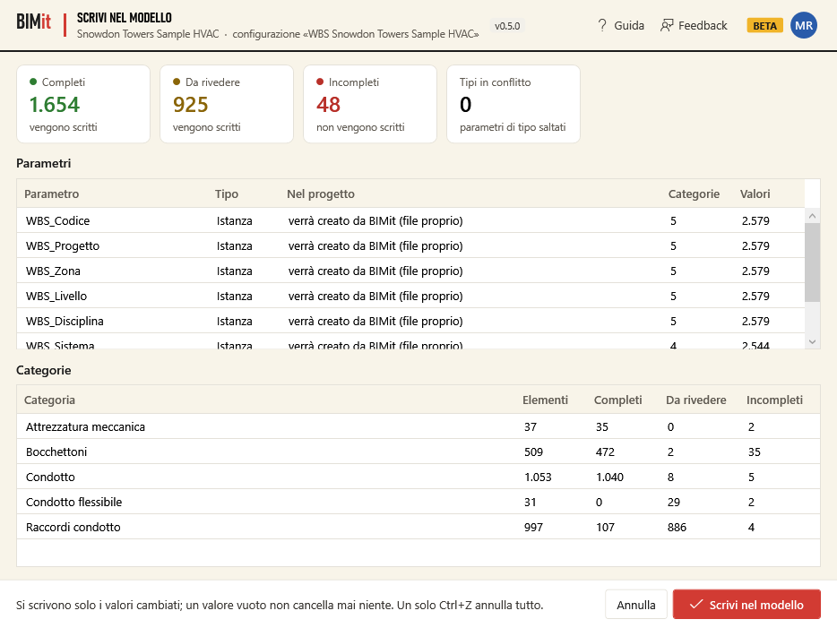

| Elemento | Cosa dice |
|---|---|
| **Completi / Da rivedere / Incompleti** | Quanti elementi e se vengono scritti (gli incompleti no). |
| **Tipi in conflitto** | Tipi i cui elementi avrebbero valori diversi per un parametro di tipo: quei parametri di tipo non vengono scritti. |
| **Parametri** | Per ogni parametro: *Istanza* o *Tipo*, e **nel progetto**: *esiste già*, *verrà creato dal file dei parametri condivisi*, *verrà creato da BIMit (file proprio)*, oppure *esiste come parametro di tipo/istanza: non verrà scritto*. Poi in quante categorie e quanti valori. |
| **Categorie** | Per ogni categoria: elementi, completi, da rivedere, incompleti. |
| **Annulla** | Torna indietro senza scrivere. |
| **Scrivi nel modello** | Crea i parametri che mancano e scrive i valori. |

**Regole di sicurezza:** si scrivono solo i valori cambiati; un valore vuoto non cancella mai
niente; tutto avviene in un'unica operazione, quindi **un solo Ctrl+Z in Revit annulla tutto**.

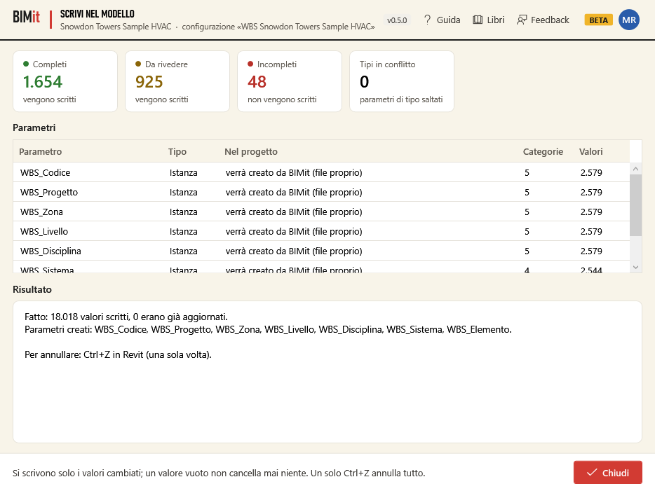

Il **Risultato** dice quanti valori sono stati scritti, quanti erano già aggiornati, quali
parametri sono stati creati e, se qualcosa non è stato scritto, perché.

**Elementi dentro i gruppi.** Revit accetta un valore su un elemento di un gruppo solo se il
parametro *può variare tra le istanze del gruppo* (il codice WBS dipende dal livello, dalla zona…).
Se tra gli elementi da scrivere ce ne sono dentro i gruppi, BIMit attiva questa opzione sui
parametri WBS di istanza e lo dice nel Risultato (*i valori ora possono variare tra le istanze dei
gruppi*). Se per un parametro non si può attivare, quegli elementi restano fra i *Non scritti* con
il motivo *dentro un gruppo*.

**Se Revit rifiuta.** La finestra di errore di Revit non si apre: se Revit rifiuta la modifica,
BIMit annulla tutto, il modello resta com'era e il Risultato dice *Nulla è stato scritto* con il
motivo dato da Revit.

---

## 10. Il dizionario Excel

Il modo più semplice per usare **i codici del committente**: scarichi la WBS in un foglio Excel, lo
compili (a mano, copiando la tabella del committente, o con un assistente IA) e lo ricarichi.

1. **Scarica dizionario…** nella finestra WBS: salva `<modello>_dizionario_WBS.xlsx` e propone di aprirlo.
2. Il foglio ha **un blocco per ogni parametro**, affiancati. In testa: il **Separatore** e un
   **Esempio** del codice, calcolato dal foglio mentre scrivi.
3. In ogni blocco, le righe di impostazione:

   | Riga | Cosa scrivere |
   |---|---|
   | **Parametro** | Il nome del parametro in Revit (es. `WBS_Disciplina`). |
   | **Cifre** | Quanti caratteri ha il codice. |
   | **Padre** | Il parametro padre (es. l'*Elemento* dipende dalla *Disciplina*), o vuoto. |
   | **Leggi da** | Cosa leggere sull'elemento: dal menu (*Livello*, *Categoria, Sistema*, *Nome famiglia, Nome tipo, Descrizione*, *Workset*, *Informazioni progetto: …*, *Testo fisso*, *Parametro: nome del parametro*, *Regole in BIMit*…). |
   | **Se non trovato** | Il codice di riserva. |
   | **Nel codice** | *Sì* se fa parte del codice completo. |

4. Sotto, una riga per codice: **Codice padre** · **Descrizione** · **Description (EN)** · **Codice** ·
   **Parole chiave** (separate da virgola).
5. **Carica dizionario…**: BIMit controlla il foglio.
   - Con **errori** non cambia niente e te li elenca (es. *Cifre deve essere un numero*).
   - Gli **avvisi** non bloccano: li vedi nel riepilogo (parametri, codici, categorie) e scegli se aggiornare.
   - Le regole e le correzioni per tipo già fatte in BIMit **restano**. Finché non premi *Salva* puoi
     ancora tornare indietro.

---

## 11. Esporta tavole e viste

Tavole e viste in **PDF, DWG, DGN, DWF/DWFx, NWC, IFC, immagini** e una **tabella dei dati** in un
colpo solo, con gli esportatori di Revit: niente stampante PDF, niente AutoCAD. Si apre con il
pulsante **Esporta** della scheda BIMit. La finestra ha tre schede, nell'ordine in cui le usi:
**1 · Selezione** (cosa esportare e con che nome), **2 · Formati** (in che formati e con quali
opzioni), **3 · Crea** (dove, la coda dei file, il report, le esportazioni pianificate).

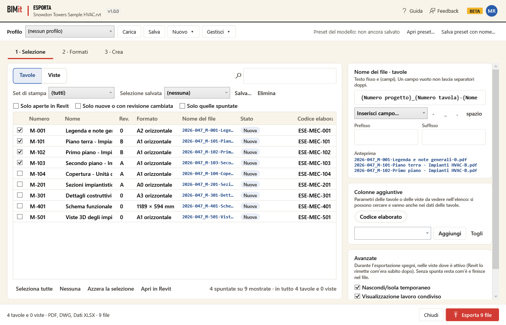

### In alto: profili e preset

Le impostazioni di esportazione di un modello (selezione, formati, nomi, cartella, coda, report)
stanno nel **preset del modello**, un file `.json` che BIMit collega al modello e salva da solo, con
lo **storico** delle esportazioni, le **selezioni salvate** e le **pianificazioni**. Un **profilo** è
lo stesso insieme di impostazioni con un nome, da riusare su altri modelli e da condividere con il
team (senza storico, selezioni e pianificazioni, che sono del modello). I profili sono in
*Documenti\BIMit\Profili esportazione*.

| Elemento | Cosa fa |
|---|---|
| **Profilo** | I profili salvati. Accanto, quale profilo è in uso nel modello e quale è il predefinito. |
| **Carica** | Usa le impostazioni del profilo scelto. Storico, selezioni salvate, pianificazioni e impostazioni delle singole tavole del modello restano. |
| **Salva** | Salva le impostazioni attuali nel profilo scelto (chiede conferma). Se non ci sono profili, chiede il nome di uno nuovo. |
| **Nuovo ▾** | Crea un profilo e lo usa: *Dalle impostazioni predefinite di BIMit*, *Dalle impostazioni attuali* o *Da un file .json* (un profilo o il preset di un collega). |
| **Gestisci ▾** | *Rinomina…*, *Elimina*, *Usa come predefinito per i nuovi modelli* (un modello aperto per la prima volta in Esporta parte da quel profilo), *Importa da una cartella (del team)…*, *Pubblica nella cartella del team come predefinito…*, *Apri la cartella dei profili*. |
| **Apri preset… · Salva preset con nome…** | Il preset del modello come file: salvalo nella cartella del progetto e i colleghi lo aprono con *Apri preset…*, con lo storico. A sinistra, il nome del file collegato. |

**Il profilo del team.** Chi gestisce gli standard sceglie una cartella condivisa (per esempio in
rete) e con *Gestisci → Pubblica nella cartella del team come predefinito…* ci copia il profilo e lo
rende il predefinito del team. Ogni collega, una volta, fa *Gestisci → Importa da una cartella (del
team)…*: BIMit copia i profili della cartella, prende il predefinito del team e ricorda la cartella.
Da lì in poi ogni modello nuovo parte dal predefinito del team (se la cartella è raggiungibile),
altrimenti dal predefinito dell'utente, altrimenti dalle impostazioni di BIMit.

### 1 · Selezione

| Elemento | Cosa fa |
|---|---|
| **Tavole · Viste** | L'elenco delle tavole o delle viste (3D, piante, sezioni, prospetti, disegni, dettagli, legende, rendering…). Puoi sceglierne da entrambi gli elenchi nella stessa esportazione. |
| **🔍 casella di ricerca** | Cerca in **tutte le colonne**: numero, nome, tipo, scala, revisione, formato carta, set di stampa, nome del file e colonne aggiuntive. Con più parole devono esserci tutte (*A1 pianta*). |
| **Set di stampa** | Solo le tavole e viste di un set di stampa del progetto. |
| **Tipo di vista** | (Viste) Solo piante, solo sezioni, solo 3D… |
| **Selezione salvata · Salva… · Elimina** | Un gruppo di tavole e viste con un nome, salvato nel modello. Sceglierla spunta le sue tavole e viste (e toglie la spunta alle altre); *Salva…* salva quelle spuntate ora con un nome (lo stesso nome la sostituisce). Le selezioni servono anche alle pianificazioni. |
| **Solo aperte in Revit** | Solo quelle aperte nelle schede di Revit. |
| **Solo nuove o con revisione cambiata** | Nasconde quelle già esportate con la stessa revisione: dopo una nuova revisione trovi subito cosa riconsegnare. |
| **Solo quelle spuntate** | Mostra solo le righe spuntate, per controllarle. |
| **Casella a sinistra di ogni riga** | Sceglie la tavola. Con più righe evidenziate (Ctrl o Shift), **Spazio** le spunta tutte. |
| **Formato** | (Tavole) Il formato della carta letto dal cartiglio (*Larghezza foglio* e *Altezza foglio*): *A1 orizzontale*, *A3 verticale*… o le misure in mm se non è un formato standard. In grassetto se l'hai cambiato per quella tavola. |
| **Nome del file** | Il nome che avrà il file, aggiornato mentre scrivi lo schema. In **rosso** se un'altra riga ha lo stesso nome (sarà salvata con *(2)*), in *corsivo* se l'hai scritto a mano. |
| **Stato** | *Nuova* (mai esportata), *Revisione cambiata*, *Esportata il …*. |
| **Clic destro su una riga** | Per le righe evidenziate soltanto: *Formato carta* e *Orientamento* (diversi da quelli dei Formati), *Nome del file…* (solo per quella riga), *Torna ai valori del profilo*, *Apri in Revit*. |
| **Seleziona tutte · Nessuna · Azzera la selezione** | Spunta o toglie quelle mostrate; *Azzera la selezione* toglie la spunta a tutte, tavole e viste. |
| **Apri in Revit** | Apre in Revit la tavola o la vista evidenziata. |

**Nome dei file** — testo fisso e **{campi}**, uno schema per le tavole e uno per le viste.
*Inserisci campo…* aggiunge un campo dove si trova il cursore: della tavola (*Numero tavola*, *Nome
tavola*, *Revisione*, *Data revisione*, *Descrizione revisione*, *Data emissione tavola*, *Disegnato
da*, *Verificato da*, *Formato carta*…), della vista (*Nome vista*, *Tipo di vista*, *Scala*), del
progetto (*Numero progetto*, *Nome progetto*, *Nome cliente*, *Organizzazione*, *Data emissione
progetto*…), *Nome del modello*, *Data di oggi*, *Ora*, *Utente*, oppure *Parametro…* per qualsiasi
parametro della tavola o vista (o delle informazioni di progetto), per esempio
`{Parametro: Codice elaborato}`. La data e l'ora accettano un formato dopo i due punti:
`{Data di oggi:yyyy-MM-dd}`, `{Ora:HH.mm}`. I pulsanti **-**, **_**, **.** e **spazio** aggiungono
un separatore. **Prefisso** e **Suffisso** sono testo prima e dopo ogni nome (anche del PDF unico e
dei dati). **Anteprima** mostra i nomi veri delle prime tavole spuntate. Un campo vuoto non lascia
separatori doppi e i caratteri non ammessi da Windows vengono tolti.

**Colonne aggiuntive** — parametri delle tavole o delle viste da vedere nell'elenco (scegli o scrivi
il nome, poi *Aggiungi*; *Togli* toglie quella evidenziata). Si possono cercare e finiscono anche
nei **dati delle tavole**.

**Avanzate** — durante l'esportazione BIMit può spegnere, nelle viste dove sono attivi,
*Nascondi/isola temporaneo*, *Visualizzazione lavoro condiviso*, *Mostra elementi nascosti* e
*Mostra vincoli*, che altrimenti finirebbero nei file. Revit li rimette com'erano subito dopo ogni
file e il modello non cambia. Senza spunta restano come sono.

### 2 · Formati

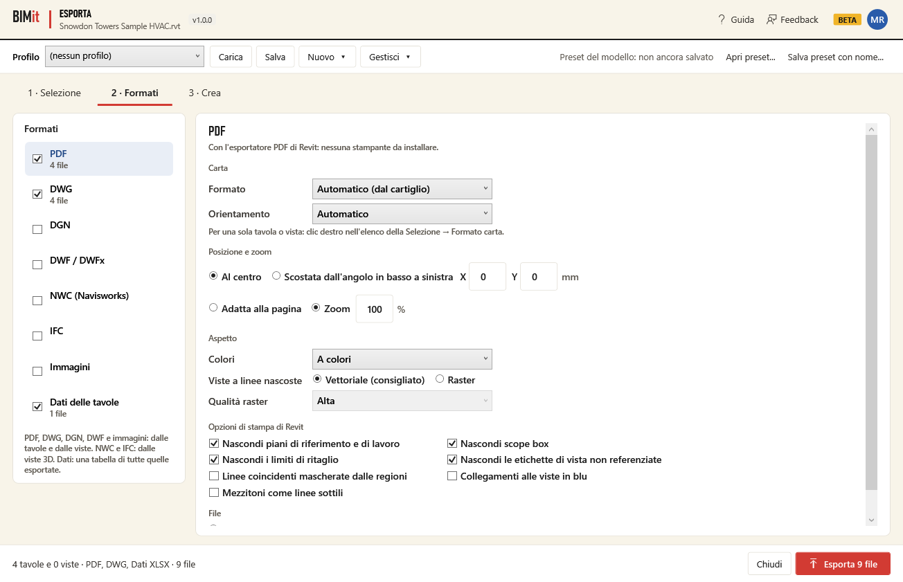

A sinistra i formati: la casella lo attiva, il clic sul nome ne mostra le opzioni; sotto il nome,
quanti file creerà. PDF, DWG, DGN, DWF e immagini si esportano dalle tavole e dalle viste; NWC e IFC
dalle **viste 3D**; i dati sono una sola tabella di tutte quelle esportate.

| Formato | Opzioni |
|---|---|
| **PDF** | *Carta*: **Automatico (dal cartiglio)** (ogni tavola con il formato del suo cartiglio; le viste su A3 adattate alla pagina) o un formato fisso (A0…A4, B1…B4, ANSI, ARCH), con l'*Orientamento*. *Posizione*: al centro o scostata dall'angolo in basso a sinistra di X e Y mm. *Zoom*: adatta alla pagina o una percentuale (100% = scala reale). *Colori* (a colori, scala di grigi, bianco e nero). *Viste a linee nascoste*: vettoriale (consigliato: linee nitide, file leggeri) o raster, con la *Qualità raster*. Le **opzioni di stampa di Revit**: nascondi piani di riferimento e di lavoro, scope box, limiti di ritaglio, etichette di vista non referenziate; linee coincidenti mascherate dalle regioni; collegamenti alle viste in blu; mezzitoni come linee sottili. *File*: un PDF per ogni tavola o vista, oppure **un solo PDF** con tutte quelle scelte, con il suo nome e *Ogni pagina con il formato della sua tavola*; l'ordine delle pagine è quello della coda (*3 · Crea*, **Su** e **Giù**). |
| **DWG** | *Impostazione*: le impostazioni di esportazione DWG del progetto (layer, colori, unità, modelli collegati inseriti o come riferimento). *Viste sulle tavole*: **unite nel file** (un solo DWG per tavola) o **come riferimenti esterni** (un DWG per ogni vista, collegato alla tavola). *Elimina i file .pcp* che Revit scrive accanto a ogni DWG. |
| **DGN** | *Impostazione*: le impostazioni di esportazione DGN del progetto. *Viste sulle tavole*: unite nel file o come riferimenti. |
| **DWF / DWFx** | DWFx (si apre anche con il visualizzatore XPS di Windows) o DWF; *Proprietà degli elementi*, *Locali e aree*, *Mostra i limiti di ritaglio*; compressione e qualità delle immagini; carta (automatica dal cartiglio o fissa) e orientamento. |
| **NWC** | Un file per ogni vista 3D: *Coordinate condivise*, *Dividi per livelli*, *ID degli elementi*, *Includi i modelli collegati*, *Parti*, *Geometria dei locali*, *Locale come attributo*, *Collegamenti (URL)*, *Converti le proprietà degli elementi*, *Converti i file CAD collegati*, *Converti le luci*, *Cerca i materiali mancanti*, *Parametri* (tutti, solo degli elementi, nessuno). Serve l'esportatore Navisworks per Revit (se manca, BIMit lo dice). |
| **IFC** | Un file per ogni vista 3D: *Versione* (IFC 2x3 CV 2.0, IFC4 Reference View, IFC4 Design Transfer View, IFC4, IFC 2x3, FM, COBie…), *Space boundaries*, *Solo gli elementi visibili nella vista*, *Coordinate condivise*, *Proprietà comuni IFC*, *Proprietà di Revit*, *Quantità di base*, *Dividi muri e pilastri per livello*. |
| **Immagini** | Un'immagine per ogni tavola o vista: *Tipo* (PNG, JPG, TIFF, BMP, TGA), *Risoluzione* (72–600 DPI), *Dimensione*: adatta a N pixel in orizzontale o in verticale, oppure zoom in % della dimensione reale. |
| **Dati delle tavole** | Una tabella **Excel, CSV o XML** con una riga per ogni tavola o vista esportata: tipo, numero, nome, tipo di vista, revisione, data revisione, formato carta, larghezza e altezza, scala, set di stampa, nome del file e le colonne aggiuntive della Selezione. *Nome del file* con i {campi}. |

### 3 · Crea

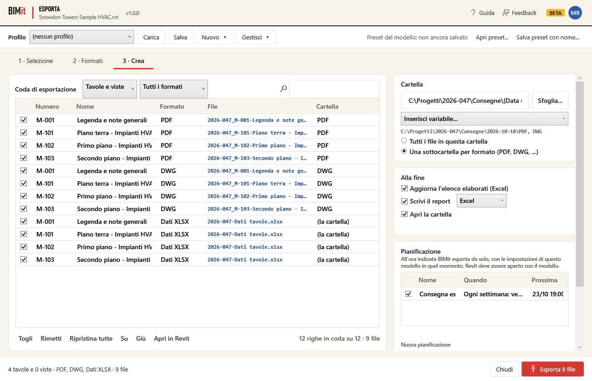

**Cartella**

| Opzione | Cosa fa |
|---|---|
| **Cartella · Sfoglia…** | Dove salvare. Il percorso può contenere **variabili**, che *Inserisci variabile…* aggiunge in fondo: *{Utente}*, *{Data di oggi}* e *{Data di oggi:yyyy-MM-dd}* (con il formato che vuoi), *{Ora}*, *{Nome del modello}*, *{Numero progetto}*, *{Nome progetto}*, *{Data emissione progetto}*, *{Formato}* (PDF, DWG…), qualsiasi parametro delle informazioni di progetto e le variabili di Windows come `%USERPROFILE%`. Per esempio `\\server\Commesse\{Numero progetto}\Consegne\{Data di oggi:yyyy-MM-dd}`. Sotto, il percorso vero. |
| **Tutti i file in questa cartella · Una sottocartella per formato** | Una sola cartella o PDF, DWG, DGN, DWF, NWC, IFC e *Immagini* in sottocartelle (i dati, l'elenco elaborati e il report restano nella cartella). Con *{Formato}* nel percorso decidi tu dove va la sottocartella. |

**Coda di esportazione** — una riga per ogni tavola o vista spuntata e ogni formato attivo, con il
nome del file e la cartella. *Tavole e viste · Solo tavole · Solo viste*, il formato e la ricerca la
filtrano.

| Elemento | Cosa fa |
|---|---|
| **Casella della riga** | Toglie o rimette la riga: tolta, quel file non viene creato (*(tolta)*). Le righe tolte restano tolte, anche alla prossima apertura, finché non le rimetti. **Spazio** cambia tutte le righe evidenziate. |
| **Togli · Rimetti · Ripristina tutte** | Toglie o rimette le righe evidenziate; *Ripristina tutte* rimette tutto. |
| **Su · Giù** | Con *Un solo PDF*: sposta le pagine evidenziate nel PDF unico. |
| **Apri in Revit** | Apre la tavola o la vista della riga evidenziata. |

**Alla fine**

| Opzione | Cosa fa |
|---|---|
| **Aggiorna l'elenco elaborati (Excel)** | Scrive *Elenco elaborati.xlsx* nella cartella: numero, titolo, revisione, data revisione, i file di ogni formato esportato e la data di esportazione di tutto quello esportato con questo modello. |
| **Scrivi il report · Excel/CSV** | Scrive nella cartella il *Report esportazione* (con la data e l'ora nel nome): per ogni file nome, formato, cartella, tavole e viste, ora, durata ed esito (con il messaggio se non è riuscito), poi la data, i file riusciti e non riusciti e il tempo totale. |
| **Apri la cartella** | Apre la cartella quando ha finito. |
| **Ultima esportazione · Apri l'ultimo report** | Quando è stata l'ultima esportazione del modello (anche se pianificata o fatta da Claude), quanti file e quanto è durata. |

**Pianificazione** — BIMit esporta da solo all'ora indicata, con le impostazioni del modello in quel
momento (formati, nomi, cartella, righe tolte). **Revit deve essere aperto con il modello**: se a
quell'ora era chiuso, l'esportazione parte una volta sola alla prima occasione dopo la riapertura.

| Elemento | Cosa fa |
|---|---|
| **Elenco** | Le pianificazioni del modello: la casella la accende o la spegne, *Quando* e la *Prossima* esecuzione. Sotto, l'ultima eseguita e il suo esito. |
| **Data · ore · ripetizione** | La prima esecuzione e poi *Una volta*, *Ogni settimana* (nei giorni che spunti; nessuno = il giorno della data) od *Ogni mese* (lo stesso giorno; nei mesi più corti l'ultimo giorno). |
| **Cosa** | *Le tavole e le viste spuntate ora* (fissate in quel momento) o una **selezione salvata** (quelle che contiene al momento dell'esecuzione). |
| **Solo nuove o con revisione cambiata** | Esporta solo quelle mai esportate o con la revisione cambiata: niente da fare, niente file. |
| **Aggiungi · Elimina** | Aggiunge la pianificazione o elimina quella evidenziata. |

### In basso

| Elemento | Cosa fa |
|---|---|
| **Messaggio** | Cosa manca (*Scegli le tavole…*, *Scegli almeno un formato…*) o cosa verrà esportato, e durante l'esportazione il file in corso (*PDF 3/20 · A101-…*) con la barra di avanzamento. |
| **Esporta N file** | Parte. Durante l'esportazione diventa **Interrompi**: si ferma dopo il file in corso. |
| **Chiudi** | Chiude e salva le impostazioni nel preset del modello. |

Alla fine BIMit apre la cartella; se qualche file non è riuscito (o l'elenco elaborati o il report
erano aperti in Excel) ti dice quale e perché. Con Claude puoi fare tutto questo a parole (gli
strumenti *tavole_…* nel capitolo [Claude (MCP)](#15-claude-mcp)): *«esporta in PDF e DWG le tavole
con la revisione cambiata»*, *«pianifica ogni venerdì alle 19 la consegna esecutivo»*.

---

## 12. Parametri: aggiungi, gestisci, pulisci le famiglie

Il pannello **Parametri** ha tre pulsanti: *Aggiungi parametri* porta nel progetto i parametri di un
file di parametri condivisi, *Gestione parametri* mostra e ripulisce i parametri di progetto,
*Parametri famiglie* toglie i parametri inutili dalle famiglie caricate.

### Aggiungi parametri

Aggiunge al progetto i parametri di un file di parametri condivisi (`.txt`). Diventano parametri di progetto, su tutte le categorie che scegli, in un'unica operazione. Il pulsante è nel pannello **Parametri** della scheda BIMit. Un parametro che il progetto ha già (stesso GUID) con lo stesso legame, istanza o tipo, riceve solo le categorie che gli mancano (e, se la spunti, l'opzione *I valori possono variare per istanza di gruppo*); con l'altro legame resta com'è. BIMit non scrive valori negli elementi e non cambia il file impostato in Revit.

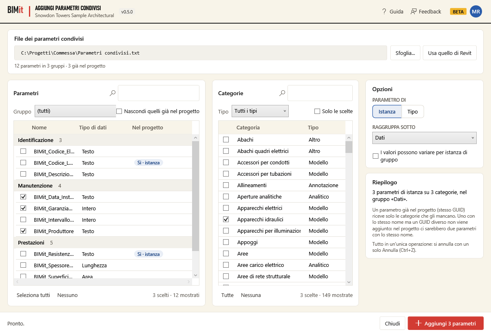

#### Prima di iniziare

- Apri un **progetto** in modifica. In una famiglia BIMit ti ricorda che lì i parametri si aggiungono da *Tipi di famiglia*.
- Se il modello è di sola lettura o in Revit c'è un comando in corso, la finestra non si apre e BIMit ti dice perché.
- Tieni pronto il file dei parametri condivisi: quello impostato in Revit o un altro.

In alto trovi l'[intestazione comune](#4-lintestazione-delle-finestre) con *Aggiungi parametri condivisi* e il nome del modello.

#### File dei parametri condivisi

| Elemento | Cosa fa |
|---|---|
| **Percorso del file** | Il file che BIMit sta leggendo. All'apertura è quello impostato in Revit (*Gestisci → Parametri condivisi*), se esiste. |
| **Sfoglia...** | Sceglie un altro file `.txt`. |
| **Usa quello di Revit** | Torna al file impostato in Revit. È disattivato se in Revit non c'è un file o se quel file non esiste più. |
| **Riga sotto** | Quanti parametri e gruppi ha il file e quanti sono già nel progetto (*12 parametri in 3 gruppi · 2 già nel progetto*). Se in Revit non c'è un file, o se non esiste più, te lo dice qui. |

BIMit **legge soltanto** il file e non cambia l'impostazione di Revit. Se Revit non riesce a leggere il file, BIMit te lo dice e l'elenco resta com'era.

#### Parametri

A sinistra ci sono i parametri del file, divisi secondo i gruppi del file. In testa a ogni gruppo vedi il nome e quanti parametri mostra. Clicca l'intestazione di una colonna per ordinare.

| Elemento | Cosa fa |
|---|---|
| **🔍 casella di ricerca** | Filtra per nome, gruppo o tipo di dati. Deve comparire ogni parola che scrivi. |
| **Gruppo** | Mostra un solo gruppo del file. *(tutti)*: tutti i gruppi. |
| **Nascondi quelli già nel progetto** | Nasconde i parametri che il progetto ha già (stesso GUID). |
| **Casella a sinistra di ogni riga** | Sceglie il parametro. Con più righe evidenziate (Ctrl o Shift), **Spazio** le spunta tutte. Se erano già tutte spuntate, toglie le spunte. |
| **Nome** | Il nome del parametro. Passa il mouse per vedere la descrizione e il GUID. |
| **Tipo di dati** | Per esempio *Testo*, *Lunghezza* (nella lingua di Revit) o *Tipo di famiglia: Porte* (la categoria nella lingua di Revit). |
| **Nel progetto** | Vuota: il parametro è nuovo. *Sì · istanza* o *Sì · tipo*: è già nel progetto con lo stesso GUID. *Nome già usato*: nel progetto c'è un altro parametro con questo nome e un GUID diverso, quindi non verrà aggiunto. Passa il mouse per il dettaglio. |
| **Seleziona tutti · Nessuno** | Spunta o toglie tutti quelli mostrati. |
| **… scelti · … mostrati** | Quanti parametri hai spuntato e quanti ne vedi con i filtri. |

#### Categorie

Al centro ci sono tutte le categorie del progetto che accettano parametri, anche quelle senza elementi. I nomi sono nella lingua di Revit.

| Elemento | Cosa fa |
|---|---|
| **🔍 casella di ricerca** | Filtra per nome della categoria. |
| **Tipo** | *Tutti i tipi*, *Modello*, *Annotazione*, *Analitico*, *Altro*. |
| **Solo le scelte** | Mostra solo le categorie spuntate. |
| **Casella a sinistra di ogni riga** | Sceglie la categoria. **Spazio** funziona come per i parametri. |
| **Categoria**, **Tipo** | Nome e tipo della categoria. |
| **Tutte · Nessuna** | Spunta o toglie tutte quelle mostrate. |
| **… scelte · … mostrate** | Quante categorie hai spuntato e quante ne vedi. |

#### Opzioni e Riepilogo

Stanno a destra. Le opzioni valgono per tutti i parametri scelti.

| Elemento | Cosa fa |
|---|---|
| **PARAMETRO DI · Istanza / Tipo** | *Istanza* (scelta all'inizio): un valore per ogni elemento. *Tipo*: un valore per tutti gli elementi dello stesso tipo. |
| **RAGGRUPPA SOTTO** | Il gruppo in cui il parametro compare nelle *Proprietà*. Puoi scegliere tutti i gruppi di Revit, più *Altro*. All'inizio è *Dati*. Vale solo per i parametri nuovi. |
| **I valori possono variare per istanza di gruppo** | Ogni istanza di un gruppo di modello può avere un valore diverso. Funziona solo con *Istanza*: con *Tipo* è disattivata. Vale anche per i parametri di istanza già nel progetto. |
| **Riepilogo** | Dice in una frase cosa farai, per esempio *3 parametri di istanza su 5 categorie, nel gruppo «Dati».* Finché manca una scelta: *Scegli i parametri e le categorie.* Sotto ci sono due promemoria: cosa succede ai parametri con lo stesso GUID o con lo stesso nome ma un GUID diverso, e il Ctrl+Z. |

#### Piede della finestra

| Elemento | Cosa fa |
|---|---|
| **Messaggio a sinistra** | Dice cosa manca: *Scegli il file dei parametri condivisi.*, *Scegli i parametri da aggiungere.*, *Scegli le categorie.* Quando è tutto pronto: *Pronto.* Dopo l'aggiunta mostra i conteggi, per esempio *Aggiunti 2, aggiornati 1, già presenti 0.* Se qualcosa non è andato, aggiunge *non aggiunti N*. |
| **Chiudi** | Chiude la finestra. |
| **Aggiungi N parametri** | Aggiunge i parametri scelti alle categorie scelte. È disattivato finché manca il file, un parametro o una categoria. |

#### Quando premi Aggiungi

Prima BIMit controlla che il file ci sia ancora e che il modello si possa modificare. Se nel frattempo il file è sparito, ti chiede di sceglierlo (*Scegli il file dei parametri condivisi.*). Se il modello è diventato di sola lettura o ha un'operazione in corso, te lo dice (*Il modello è di sola lettura o ha un'operazione in corso.*). In questi casi non fa nulla.

Poi rilegge il file. Se Revit non riesce a rileggerlo, compare *Impossibile aggiungere i parametri* con il motivo: il modello non cambia e le spunte restano. Altrimenti BIMit controlla ogni parametro scelto in base al GUID:

| Il parametro | Cosa succede | Nel resoconto |
|---|---|---|
| **Nuovo** | Diventa un parametro di progetto, di istanza o di tipo. Va sulle categorie scelte, nel gruppo indicato in *RAGGRUPPA SOTTO*. Se è di istanza e hai spuntato *I valori possono variare per istanza di gruppo*, riceve anche questa opzione. | **Aggiunti** |
| **Già nel progetto, stesso legame** (istanza e istanza, tipo e tipo) | Riceve le categorie che gli mancano. Le categorie che ha già restano. Tiene il suo gruppo. Se hai spuntato *I valori possono variare per istanza di gruppo*, riceve anche questa opzione. | **Parametri già nel progetto aggiornati**, con la modifica fatta (*+2 categorie*, *valori variabili per gruppo*) |
| **Già nel progetto, niente da cambiare** | Resta com'è. | **Già presenti** |
| **Già nel progetto con l'altro legame** | Resta com'è. BIMit non trasforma un parametro di istanza in uno di tipo, né il contrario. | **Già presenti** (*… non modificato*) |
| **Nome già usato** | Non viene aggiunto, perché nel progetto ci sarebbero due parametri con lo stesso nome. | **Non aggiunti** |

Tutto avviene in un'unica operazione. Nell'elenco *Annulla* di Revit la trovi come *BIMit: aggiungi parametri condivisi*.

**Il resoconto**

Alla fine un messaggio elenca i parametri voce per voce. Compaiono solo le voci con almeno un parametro, ciascuna con il suo numero (per esempio *Aggiunti: 3*). Per ogni voce vedi le prime 12 righe, poi *... e altri N*. Se Revit ha annullato la modifica, lo dice in testa al messaggio.

| Voce | Cosa contiene |
|---|---|
| **Aggiunti** | I parametri nuovi. |
| **Parametri già nel progetto aggiornati** | I parametri che hanno ricevuto categorie o l'opzione per i gruppi. |
| **Già presenti** | I parametri già a posto e quelli con l'altro legame (*non modificato*). |
| **Non aggiunti** | Ogni parametro con il suo motivo, per esempio *nel progetto c'è già un parametro con lo stesso nome (GUID diverso)*, *non è più nel file* (qui al posto del nome compare il GUID) o *in uso da …*. Con *aggiunto, ma i valori non possono variare per gruppo* il parametro è stato aggiunto senza quell'opzione: compare anche in **Aggiunti** e conta in entrambi i numeri in basso. Con *già nel progetto, i valori non possono variare per gruppo* non ha ricevuto quell'opzione; se ha ricevuto categorie, compare anche negli aggiornati. |

Se c'è almeno un *Non aggiunti* o un errore, il resoconto compare come messaggio di errore.

Prima ancora del messaggio BIMit rilegge il file: la colonna **Nel progetto** e la riga sotto il percorso si aggiornano e le spunte dei parametri si tolgono (anche se Revit ha annullato la modifica). Le categorie restano spuntate, così puoi fare subito un'altra aggiunta, per esempio dei parametri di tipo.

#### Da sapere

- **Un solo Ctrl+Z.** Ogni **Aggiungi** è un'unica operazione e un Ctrl+Z in Revit la annulla tutta. Se fai più aggiunte di seguito, si annullano una alla volta.
- **Se non c'è niente da cambiare** (sono tutti *Già presenti* o *Non aggiunti*), BIMit non tocca il modello.
- **Errori di Revit.** Gli avvisi di Revit non fermano l'operazione. Un errore invece annulla tutto e il modello resta com'era. Il resoconto dice *Revit ha annullato la modifica* e, se Revit lo indica, ne spiega il motivo. *Aggiunti* e *Parametri già nel progetto aggiornati* non compaiono. Il messaggio in basso dice *Nessuna modifica.*
- **Il file `.txt` non cambia.** BIMit lo legge soltanto. Per leggerlo imposta il file in Revit per un attimo, poi rimette l'impostazione com'era, anche se era vuota. BIMit non crea né modifica file di parametri condivisi.
- **Nessun valore.** I parametri vengono aggiunti, ma BIMit non scrive valori negli elementi.
- **Cosa non cambia mai:**
  - le categorie che un parametro ha già: BIMit ne aggiunge, non ne toglie;
  - il legame istanza/tipo e il gruppo dei parametri già nel progetto;
  - i parametri che hanno lo stesso nome ma un GUID diverso;
  - l'opzione *I valori possono variare per istanza di gruppo*: BIMit la attiva e basta, non la toglie mai.
- **Nomi doppi.** BIMit confronta il nome con tutti i parametri di progetto, condivisi e non. Se nel file due parametri scelti hanno lo stesso nome, aggiunge solo il primo nell'ordine in cui la finestra li mostra all'apertura (gruppi in ordine alfabetico); come hai ordinato le colonne non conta. L'altro finisce in **Non aggiunti** con il motivo *nel progetto c'è già un parametro con lo stesso nome (GUID diverso)*.
- **Spunte nascoste.** Parametri e categorie spuntati restano scelti anche quando un filtro li nasconde. Controlla i conteggi *scelti* e *scelte*; per le categorie puoi anche usare **Solo le scelte**.
- **Modello condiviso.** Un parametro già nel progetto deve ricevere categorie o l'opzione per i gruppi, ma un altro utente lo sta usando o è cambiato nel modello centrale? Allora resta intatto. Finisce in *Non aggiunti* con il motivo *già nel progetto, non modificato (in uso da …)* oppure *già nel progetto, non modificato (è cambiato nel modello centrale: ricarica l'ultima versione e riprova)*. Se non c'è niente da cambiare, o se ha l'altro legame, finisce in *Già presenti* come sempre. Gli altri parametri vengono aggiunti lo stesso.

### Gestione parametri

Tutti i parametri di progetto del modello in un solo elenco. Per ognuno vedi se è condiviso o di progetto, se è di istanza o di tipo, a quali categorie è assegnato e quanti elementi hanno un valore. Così trovi subito i parametri vuoti o inutili, esporti l'elenco in CSV ed elimini quelli che non servono in un'unica operazione. Si apre con il pulsante **Gestione parametri** del pannello *Parametri* nella scheda BIMit; la finestra si chiama *Parametri del progetto*.

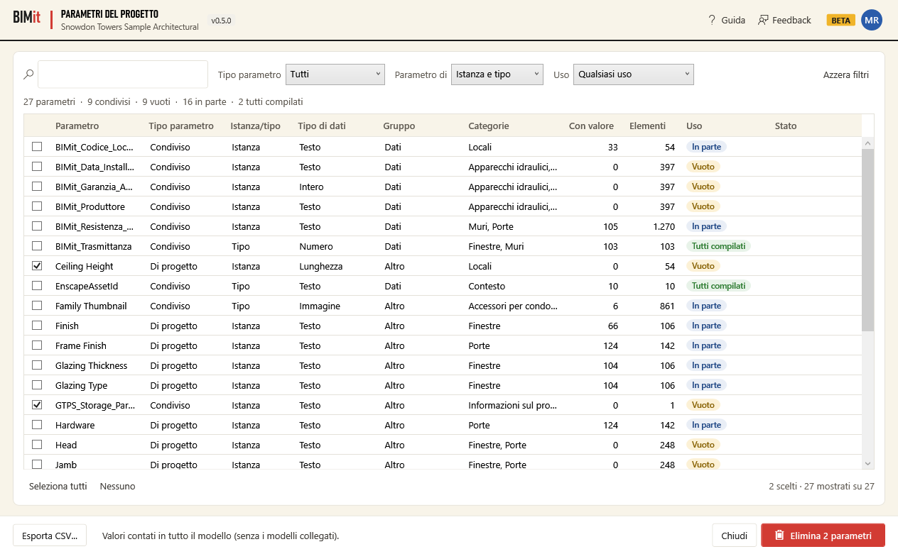

#### Prima di iniziare

- Apri un **progetto**. In un file di famiglia BIMit ti dice che le famiglie non hanno parametri di progetto.
- Il modello deve essere modificabile. Se è di sola lettura, o se in Revit c'è un'operazione in corso, la finestra non si apre.

In alto c'è l'[intestazione](#4-lintestazione-delle-finestre) con il nome del modello. L'elenco mostra i parametri in ordine alfabetico. Appena si apre la finestra, BIMit inizia a contare i valori (vedi *Il conteggio dei valori*).

#### Filtri

| Elemento | Cosa fa |
|---|---|
| **🔍 casella di ricerca** | Filtra per nome, tipo parametro, istanza/tipo, tipo di dati, gruppo, categorie e uso. Se scrivi più parole, ognuna deve comparire in una di queste colonne. Maiuscole e minuscole non contano. |
| **Tipo parametro** | *Tutti*, *Condivisi* (con GUID) oppure *Di progetto* (non condivisi). |
| **Parametro di** | *Istanza e tipo*, *Istanza* oppure *Tipo*. |
| **Uso** | *Qualsiasi uso*; *Vuoti* (già contati e senza valori in nessun elemento, compresi quelli che non hanno elementi); *Con valori* (almeno un elemento ha un valore); *Non contati*. |
| **Azzera filtri** | Svuota la ricerca e rimette *Tutti*, *Istanza e tipo* e *Qualsiasi uso*. |
| **Riepilogo** (sotto i filtri) | Quanti parametri ci sono e quanti sono condivisi. Dopo il conteggio aggiunge quanti sono *vuoti* (compresi quelli *Nessun elemento*), *in parte* e *tutti compilati*. Se il conteggio non è finito, dice anche quanti sono *non contati*. I parametri già eliminati non sono compresi. |
| **Conta i valori** | Compare solo se il conteggio è stato interrotto o non è riuscito. Lo rifà da capo per tutti i parametri. |

#### L'elenco dei parametri

Per ordinare, clicca un'intestazione.

| Colonna | Cosa mostra |
|---|---|
| **Casella a sinistra** | Spunta il parametro da eliminare. All'apertura nessuna casella è spuntata. Se evidenzi più righe (Ctrl o Shift), **Spazio** le spunta tutte. Se erano già tutte spuntate, toglie la spunta. |
| **Parametro** | Il nome. Passa il mouse sopra: vedi il **GUID** se il parametro è condiviso, altrimenti *Parametro di progetto non condiviso*. |
| **Tipo parametro** | *Condiviso* o *Di progetto*. |
| **Istanza/tipo** | *Istanza* o *Tipo*. |
| **Tipo di dati** | Nella lingua di Revit, per esempio *Testo*, *Lunghezza* o *Tipo di famiglia: Porte*. |
| **Gruppo** | Il gruppo delle proprietà in cui Revit mostra il parametro (per esempio *Dati*). Se il parametro non ha un gruppo, compare *Altro*. |
| **Categorie** | Le categorie a cui il parametro è assegnato. Passa il mouse sopra per vederle una per riga. *-* vuol dire nessuna categoria. |
| **Con valore** | Quanti elementi hanno un valore. *–* vuol dire che il parametro non è ancora stato contato. |
| **Elementi** | Quanti elementi hanno il parametro. Per un parametro di tipo si contano i **tipi**, non le istanze. *–* vuol dire non ancora contato. |
| **Uso** | *Tutti compilati*, *In parte*, *Vuoto*, *Nessun elemento* (nessun elemento ha il parametro) oppure *Non contato*. |
| **Stato** | Vuoto finché non elimini qualcosa. Dopo mostra *Eliminato* oppure *Non eliminato*. Per il motivo, passa il mouse sopra. |

Sotto l'elenco:

| Elemento | Cosa fa |
|---|---|
| **Seleziona tutti** | Spunta tutti i parametri mostrati dai filtri. |
| **Nessuno** | Toglie la spunta ai parametri mostrati. |
| **Contatore a destra** | Mostra *N scelti · N mostrati su N*. Se alcuni parametri spuntati sono nascosti dai filtri, aggiunge *· N scelti nascosti dai filtri (non vengono eliminati)*. Il totale (*su N*) comprende anche le righe già eliminate. |

#### Piede della finestra

| Elemento | Cosa fa |
|---|---|
| **Esporta CSV…** | Salva i parametri mostrati in un file CSV (vedi sotto). |
| **Messaggio e barra** | Mostrano il conteggio in corso (*Conteggio dei valori 3/25 · Porte*: lettura 3 di 25; una categoria con parametri sia di istanza sia di tipo si legge due volte e conta due volte nel totale, vedi *Il conteggio dei valori*) e l'esito delle operazioni, per esempio *Conteggio non riuscito: …* |
| **Interrompi** | Compare solo durante il conteggio. Lo ferma poco dopo averlo premuto. |
| **Chiudi** | Chiude. Durante il conteggio è disattivato. |
| **Elimina** | Disattivato durante il conteggio e finché non spunti almeno un parametro tra quelli mostrati. Poi diventa *Elimina N parametri* (*Elimina 1 parametro*) ed elimina i parametri spuntati **tra quelli mostrati**. |

#### Il conteggio dei valori

Per ogni parametro BIMit conta quanti elementi lo hanno e quanti hanno un valore. Legge una categoria alla volta. Se una categoria ha parametri sia di istanza sia di tipo, la legge due volte: una per gli elementi e una per i tipi. Mentre conta, l'elenco, **Elimina**, **Chiudi** ed **Esporta CSV…** sono disattivati. I filtri, **Seleziona tutti** e **Nessuno** restano utilizzabili. Il conteggio legge soltanto: il modello non cambia.

- Quando un elemento ha un valore:
  - un testo ha un valore se non è vuoto (un testo fatto solo di spazi conta come vuoto);
  - un numero o un *Sì/No* ha un valore se è stato impostato, anche se vale 0 o *No*;
  - un riferimento (per esempio un tipo di famiglia) ha un valore se è impostato, cioè se non è `<Nessuno>`.
- BIMit legge solo il modello aperto, non i modelli collegati. Alla fine vedi *Valori contati in tutto il modello (senza i modelli collegati).*
- Se premi **Interrompi**, vedi *Conteggio interrotto: i parametri non contati hanno «–».* I parametri già contati restano contati. Per completare premi **Conta i valori**: il conteggio riparte da capo per tutti i parametri. Se lo interrompi di nuovo, restano contati solo quelli finiti in questo giro.
- Se chiudi la finestra con la **X** durante il conteggio, il conteggio si ferma ma la finestra resta aperta. Poi puoi chiuderla.
- Un parametro senza categorie risulta *Nessun elemento*.

#### Esporta CSV

- Il file contiene i parametri **mostrati** con i filtri attuali, nello stesso ordine dell'elenco, tranne quelli già eliminati. Se non ce ne sono, BIMit dice *Nessun parametro da esportare.*
- Il nome proposto è `<modello>_parametri.csv`, nella cartella *Documenti*.
- Le colonne sono *Parametro*, *Tipo parametro*, *Istanza/tipo*, *Tipo di dati*, *Gruppo*, *Categorie*, *GUID* (solo per i condivisi), *Con valore*, *Elementi*, *Uso* e *Id elemento*. *Con valore* ed *Elementi* restano vuote per i parametri non contati.
- Il formato è pensato per Excel in italiano: separatore `;`, UTF-8 (gli accenti restano corretti).
- Dopo il salvataggio, in basso leggi *CSV salvato: …* con il percorso del file e il numero di parametri.
- Se vedi *Impossibile salvare il file (è aperto in Excel?)*, chiudi il file in Excel e riprova.

#### Eliminare i parametri

1. Filtra l'elenco (per esempio **Uso** → *Vuoti*) e spunta i parametri da eliminare.
2. Premi **Elimina N parametri**. Prima BIMit controlla che il modello sia ancora modificabile. Se è diventato di sola lettura o c'è un'operazione in corso, vedi *Il modello è di sola lettura o ha un'operazione in corso.* e non viene eliminato niente. Altrimenti la finestra *BIMit · Elimina parametri* ti chiede conferma e ti mostra:
   - i nomi (fino a 12), con tipo parametro e istanza/tipo; se sono di più, *... e altri N*;
   - **ATTENZIONE**, se qualche parametro ha valori negli elementi: quei valori andranno persi;
   - quanti parametri non sono stati contati, cioè quelli di cui non sai se hanno valori;
   - per i parametri condivisi, che vengono tolti dal progetto ma la loro definizione resta nelle famiglie che la usano;
   - *Si annulla con un solo Annulla (Ctrl+Z).*
3. **Sì** elimina. **No** torna all'elenco e non cambia niente.

| Parametro | Cosa succede |
|---|---|
| **Di progetto** | Viene eliminato del tutto: definizione, categorie e valori. |
| **Condiviso** | Viene tolto dai parametri di progetto. Gli elementi delle categorie a cui era assegnato non lo hanno più, e i loro valori vanno persi. La definizione condivisa (GUID) resta nel modello, anche se non compare più nell'elenco, e nelle famiglie che la usano: gli elementi di quelle famiglie conservano il parametro e il suo valore. |

**Il risultato**

- Nella colonna **Stato** compare *Eliminato* oppure *Non eliminato*. Le righe eliminate restano nell'elenco, ma non puoi più spuntarle. Le righe non eliminate restano spuntate.
- In basso leggi *Eliminati N.* Se qualcosa non è riuscito, leggi *Eliminati N, non eliminati M.*
- Se qualche parametro non è stato eliminato, compare una finestra con il numero dei parametri eliminati e l'elenco (fino a 15) di quelli scartati, ognuno con il suo motivo. Se Revit ha annullato l'eliminazione, la finestra mostra il messaggio di Revit e *Eliminati: 0*. Il motivo di ogni riga è nel suggerimento della colonna **Stato**.
- Se l'eliminazione si ferma per un errore imprevisto, vedi *Eliminazione non riuscita:* con il messaggio dell'errore.

| Motivo | Significato |
|---|---|
| *non è più nel progetto* | Il parametro non c'è più nel modello. |
| *in uso da un altro utente* | Il modello è condiviso e un altro utente ha preso in prestito il parametro. |
| *Revit non ha rimosso il parametro* / *Revit non ha eliminato il parametro* | Revit ha rifiutato l'operazione su quel parametro. |
| *è ancora nel progetto* | Dopo l'eliminazione BIMit ricontrolla il modello e trova ancora il parametro. |
| *Revit ha annullato l'eliminazione…* | Revit ha dato un errore. Non viene eliminato niente e il messaggio dice perché. |
| *altro testo* | Il messaggio di errore di Revit per quel parametro. Gli altri parametri vengono eliminati comunque. |

#### Da sapere

- **Un solo Ctrl+Z** in Revit annulla tutta l'eliminazione. Nell'elenco delle operazioni di Revit si chiama *BIMit: elimina parametri di progetto*.
- Se Revit dà un errore durante l'eliminazione, annulla tutto e il modello resta com'era. Gli avvisi di Revit non fermano l'operazione.
- Se nessuno dei parametri scelti si può eliminare, il modello non cambia.
- Vengono eliminati solo i parametri spuntati **e** mostrati. I parametri spuntati ma nascosti dai filtri restano nel modello.
- BIMit riconosce ogni parametro dal suo Id in Revit, mai dal nome. Un parametro globale o un altro parametro con lo stesso nome non viene mai toccato. I parametri globali non compaiono nell'elenco.
- Compaiono solo i parametri di progetto, condivisi o no. I parametri delle famiglie non sono in questo elenco: per quelli usa **Parametri famiglie**.
- Il file dei parametri condivisi non viene toccato.
- Nei modelli condivisi, i parametri presi in prestito da un altro utente vengono saltati; gli altri vengono eliminati. Se un parametro è stato modificato nel centrale dopo l'ultimo aggiornamento, Revit può annullare tutta l'eliminazione: ricarica l'ultima versione e riprova. Come ogni modifica, i colleghi la vedono dopo che hai sincronizzato con il centrale.
- Il conteggio non legge i modelli collegati e non modifica il modello.
- Se il progetto non ha parametri di progetto, in basso leggi *Nel progetto non ci sono parametri di progetto.*

### Parametri famiglie

Toglie dalle famiglie caricate nel progetto i parametri che non servono, senza aprirle a mano una per una. BIMit apre ogni famiglia in background e ti mostra i suoi parametri: condivisi o di famiglia, di istanza o di tipo, e se sono usati in formule, quote o associazioni. Elimina quelli che spunti e ricarica la famiglia nel progetto, mantenendo i valori. Si apre con il pulsante **Parametri famiglie** del pannello **Parametri** nella scheda BIMit. La finestra si chiama **Parametri delle famiglie**. Per i pulsanti in alto vedi [L'intestazione delle finestre](#4-lintestazione-delle-finestre).

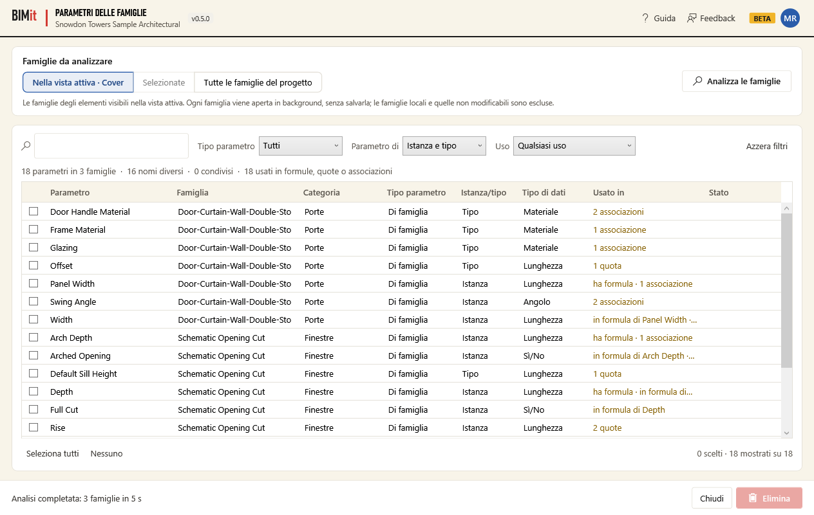

#### Prima di iniziare

- Apri un **progetto** in modifica. Il pulsante non apre la finestra da un file di famiglia, da un modello di sola lettura o con un'operazione di Revit in corso, e ti dice perché.
- Se vuoi lavorare solo su alcune famiglie, **selezionale prima** di premere il pulsante: elementi, etichette, oppure famiglie o tipi nel Browser di progetto. La finestra usa la selezione di quel momento.
- Chiudi nell'**Editor di famiglie** le famiglie da analizzare: quelle aperte vengono saltate.

#### Famiglie da analizzare

| Elemento | Cosa fa |
|---|---|
| **Nella vista attiva · *nome della vista*** | Le famiglie degli elementi visibili nella vista attiva, comprese etichette e altre annotazioni. È la scelta di partenza. |
| **Selezionate (N elementi)** | Le famiglie degli elementi selezionati. È disattivato se non hai selezionato niente. Gli elementi di sistema (muri, pavimenti…) non hanno una famiglia caricata e vengono ignorati. |
| **Tutte le famiglie del progetto** | Tutte le famiglie caricate, anche quelle senza elementi nel modello. L'analisi può richiedere alcuni minuti. |
| **Testo sotto le opzioni** | Ti ricorda cosa viene analizzato. Ogni famiglia viene aperta in background, senza salvarla. |
| **Analizza le famiglie** | Apre le famiglie una alla volta e ne legge i parametri. Sostituisce l'elenco dell'analisi precedente. Se non trova famiglie da analizzare, l'elenco precedente resta. |

Durante l'analisi il piede della finestra mostra *Analisi 12/40 · nome della famiglia* e compare **Interrompi**. Alla fine vedi un riepilogo, per esempio *Analisi completata: 40 famiglie in 35 s · 2 escluse (locali o non modificabili) · 1 non analizzata*. Se premi **Interrompi**, il riepilogo comincia con *Analisi interrotta:* e l'elenco contiene solo le famiglie già analizzate. Se una famiglia non si apre, un messaggio la elenca con il motivo (fino a 15 famiglie).

In certi casi BIMit non avvia l'analisi e ti dice perché: non trova famiglie modificabili, il modello è di sola lettura o ha un'operazione in corso, oppure nella vista attiva non si possono cercare famiglie. Nell'ultimo caso scegli **Selezionate** o **Tutte le famiglie del progetto**. In tutti questi casi l'elenco precedente resta.

#### Filtri

| Elemento | Cosa fa |
|---|---|
| **🔍 casella di ricerca** | Filtra per parametro, famiglia, categoria, tipo parametro (*Condiviso*/*Di famiglia*), istanza o tipo, tipo di dati o uso. Non distingue maiuscole e minuscole. Se scrivi più parole, devono esserci tutte. |
| **Tipo parametro** | *Tutti*, *Condivisi*, *Di famiglia*. |
| **Parametro di** | *Istanza e tipo*, *Istanza*, *Tipo*. |
| **Uso** | *Qualsiasi uso*, *Non usati*, *In formule, quote o associazioni*. |
| **Azzera filtri** | Svuota la ricerca e rimette i tre filtri sulla prima voce. |

Sotto i filtri c'è una riga di riepilogo: *N parametri in N famiglie · N nomi diversi · N condivisi · N usati in formule, quote o associazioni*. La riga conta tutti i parametri analizzati, anche quelli nascosti dai filtri, ma non quelli già eliminati. Prima della prima analisi dice *Scegli le famiglie e premi «Analizza le famiglie».*

#### Tabella dei parametri

C'è una riga per ogni parametro di ogni famiglia. I parametri di sistema di Revit non compaiono, perché non si possono eliminare. Clicca un'intestazione per ordinare.

| Colonna | Significato |
|---|---|
| **Casella** | Spunta i parametri da eliminare. Evidenzia più righe (Ctrl o Shift) e premi **Spazio**: le spunti tutte, oppure togli la spunta se erano già tutte spuntate. Un parametro già eliminato non si può più spuntare. |
| **Parametro** | Il nome. Passa il mouse per vedere il GUID (se è condiviso) e la formula (se ne ha una). |
| **Famiglia**, **Categoria** | La famiglia che contiene il parametro e la sua categoria. |
| **Tipo parametro** | *Condiviso* o *Di famiglia*. |
| **Istanza/tipo** | *Istanza* o *Tipo*. |
| **Tipo di dati** | Nella lingua di Revit: *Lunghezza*, *Testo*, *Tipo di famiglia: Porte*… |
| **Usato in** | Dove il parametro è usato nella famiglia. *in formula di …*: i parametri che lo usano nella loro formula. *N quote*: le quote che hanno la sua etichetta. *N associazioni*: i parametri di elementi della famiglia associati a lui. *ha formula* e *di report* sono solo informazioni. |
| **Stato** | È vuoto finché non elimini. Poi diventa *Eliminato*, *Non eliminato* (passa il mouse per vedere il motivo) o *Ancora presente*. |

Per il filtro **Uso** un parametro è *usato* solo se compare nella formula di un altro parametro, in una quota o in un'associazione. *ha formula* e *di report* non contano.

#### Sotto la tabella

| Elemento | Cosa fa |
|---|---|
| **Seleziona tutti** | Spunta tutti i parametri mostrati dai filtri. |
| **Nessuno** | Toglie la spunta a quelli mostrati. |
| **Contatore a destra** | *N scelti in N famiglie · N mostrati su N*. Se dei parametri spuntati sono nascosti dai filtri, aggiunge *N scelti nascosti dai filtri (non vengono eliminati)*. |

#### Piede della finestra

| Elemento | Cosa fa |
|---|---|
| **Messaggio a sinistra e barra** | Mostra il lavoro in corso (*Analisi…*, *Eliminazione 2/5 · nome della famiglia*, *Verifica…*) e poi l'esito. |
| **Interrompi** | Compare durante l'analisi e l'eliminazione. Si ferma dopo la famiglia in corso e il messaggio diventa *Interruzione dopo la famiglia in corso...*. La verifica finale dopo l'eliminazione non si interrompe: arriva comunque in fondo. |
| **Chiudi** | Chiude. È disattivato durante l'analisi e l'eliminazione. |
| **Elimina N parametri** | Elimina i parametri spuntati **e mostrati**. Finché non c'è almeno un parametro spuntato tra quelli mostrati e non ancora eliminati, resta disattivato e si chiama solo **Elimina**. Resta disattivato anche se tutti i parametri spuntati sono nascosti dai filtri. |

#### Cosa succede quando elimini

Prima BIMit chiede conferma e ti mostra le famiglie con i loro parametri. Mostra fino a 10 famiglie e 6 parametri per famiglia; gli altri compaiono come *...*. Se un parametro è usato in formule, quote o associazioni, compare un avviso *ATTENZIONE*: Revit elimina anche le formule che lo usano e le etichette delle quote. Se il modello è di sola lettura o ha un'operazione in corso, BIMit si ferma prima e te lo dice.

Poi lavora famiglia per famiglia:

1. in un modello condiviso, controlla che la famiglia non sia in uso da un altro utente;
2. apre la famiglia in background;
3. controlla che ogni parametro sia ancora quello analizzato: stesso nome, ancora condiviso o di famiglia come prima e, se è condiviso, stesso GUID;
4. elimina i parametri;
5. ricarica la famiglia nel progetto: i valori dei parametri che restano non cambiano e le famiglie annidate condivise restano quelle del progetto;
6. chiude la famiglia senza salvarla.

Alla fine BIMit rilegge le famiglie ricaricate (*Verifica delle famiglie ricaricate…*) e aggiorna la tabella. Le righe eliminate diventano *Eliminato* e non si possono più spuntare.

**Il resoconto.** Nel piede leggi *Eliminati N parametri da N famiglie*. Se serve, si aggiungono *non eliminati N* e *interrotto: N non elaborati*. I parametri non elaborati restano spuntati, con **Stato** vuoto. Un messaggio riporta poi l'esito di ogni famiglia (fino a 20): *Famiglia: eliminati A, B* oppure *Famiglia: X non eliminato (motivo)*.

| Motivo | Cosa fare |
|---|---|
| *famiglia in uso da un altro utente* | Il modello è condiviso e la famiglia è in prestito a un collega. Chiedigli di sincronizzare rilasciando gli elementi, poi riprova. |
| *la famiglia è aperta nell'Editor di famiglie: chiudila e riprova* | Chiudi la famiglia nell'Editor di famiglie e riprova. |
| *la famiglia non è più nel progetto*, *famiglia non modificabile*, *Revit non ha aperto la famiglia* | La famiglia è cambiata dopo l'analisi, oppure Revit non è riuscito ad aprirla. Premi di nuovo **Analizza le famiglie** e riprova. |
| *non trovato: analizza di nuovo*, *è cambiato: analizza di nuovo* | Il parametro è cambiato dopo l'analisi (nome, condiviso o di famiglia, GUID). Premi di nuovo **Analizza le famiglie**. |
| *Revit non ha eliminato il parametro*, oppure un messaggio di Revit | Revit ha rifiutato solo quel parametro, che resta nella famiglia. Gli altri parametri della stessa famiglia vanno avanti normalmente. |
| *modifica della famiglia annullata*, a volte seguito da *: …* | Revit ha segnalato un errore nella famiglia. Se Revit ha dato una descrizione, la trovi dopo i due punti. Per quella famiglia non è stato eliminato niente. |
| *ricaricamento non riuscito*, a volte seguito dal messaggio di Revit | Revit non ha ricaricato la famiglia. Nel progetto quella famiglia non cambia. |
| *modifica non applicata al progetto: …* | C'è stato un errore imprevisto, per esempio durante il ricaricamento, e lo trovi dopo i due punti. Nel progetto la famiglia non cambia: analizza di nuovo e riprova. |
| *Ancora presente* (colonna **Stato**) | La famiglia è stata ricaricata, ma il parametro c'è ancora. Nel resoconto compare lo stesso tra gli eliminati. |

#### Da sapere

- **Basta un solo Ctrl+Z.** Tutte le famiglie vengono modificate e ricaricate in un'unica operazione, che nell'elenco *Annulla* di Revit si chiama *BIMit: elimina parametri delle famiglie*. Se Revit non permette di ricaricare le famiglie in un'unica operazione, BIMit va avanti famiglia per famiglia: in quel caso serve un Ctrl+Z per ogni famiglia.
- **Interrompi** si ferma dopo la famiglia in corso. Le famiglie già elaborate restano modificate; puoi annullarle con Ctrl+Z.
- Durante l'analisi e l'eliminazione la finestra non si chiude: se provi a chiuderla, è come premere **Interrompi**.
- La finestra blocca Revit finché è aperta: per cambiare la selezione o la vista attiva, chiudila, fai la modifica e riaprila.
- La modifica vale per **tutte le istanze e tutti i tipi** della famiglia, anche fuori dalla vista attiva.
- Vengono eliminati solo i parametri spuntati **e mostrati** dai filtri.
- Il file `.rfa` della libreria non cambia: BIMit modifica solo la famiglia caricata nel progetto e non la salva. Se ricarichi la famiglia dalla libreria, i parametri eliminati tornano.
- Non vengono toccati i parametri di sistema di Revit, le famiglie locali e le famiglie non modificabili.
- La colonna **Usato in** guarda solo dentro la famiglia. Non controlla abachi, etichette o filtri del progetto che mostrano il parametro.
- Gli avvisi di Revit dentro la famiglia si chiudono da soli. Se Revit rifiuta subito un parametro, resta solo quel parametro (il motivo è il messaggio di Revit) e gli altri della stessa famiglia vengono eliminati. Se invece Revit segnala un errore quando conferma la modifica della famiglia, per quella famiglia non viene eliminato niente (*modifica della famiglia annullata*). L'errore non tocca le altre famiglie.
- **Modelli condivisi:** le famiglie in uso da un altro utente vengono saltate. I colleghi vedono le modifiche dopo che hai sincronizzato con il centrale.
- BIMit non salva il resoconto in un file: compare solo a video. L'elenco non viene salvato, quindi quando riapri la finestra devi analizzare di nuovo.
- Se Revit interrompe l'operazione, BIMit te lo dice: analizza di nuovo le famiglie prima di continuare.

---

## 13. Modello: sblocca, sposta livello, esporta per IA

Il pannello **Modello** ha tre pulsanti che lavorano su tutto il modello: *Sblocca tutto*,
*Sposta livello* ed *Esporta per IA*.

### Sblocca tutto

Sblocca in un colpo solo gli elementi bloccati del modello, della vista attiva o della selezione. BIMit li conta categoria per categoria e tu scegli quali sbloccare. Collegamenti, livelli, griglie, scope box, punti base, elementi delle facciate continue e parti delle ringhiere restano bloccati se non li scegli tu. Gli elementi dentro i gruppi da qui non si sbloccano mai. Si apre con il pulsante **Sblocca tutto** del pannello **Modello**. La finestra si chiama *Sblocca elementi*.

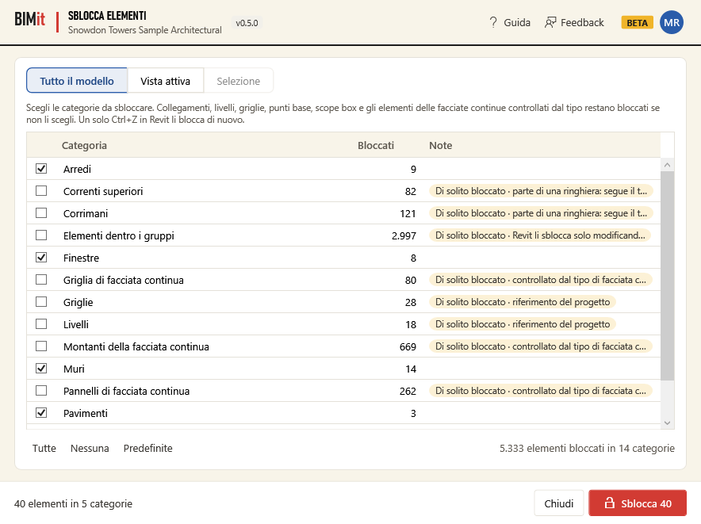

**Prima di iniziare**

- Apri un progetto. Con una famiglia aperta BIMit non apre la finestra.
- Vuoi lavorare solo su alcuni elementi? Selezionali in Revit **prima** di premere il pulsante. Finché la finestra è aperta, Revit aspetta e la selezione non cambia.
- In un modello condiviso, sincronizza prima. Gli elementi in uso da altri o modificati nel modello centrale non si sbloccano.

#### In alto: dove cercare

| Elemento | Cosa fa |
|---|---|
| **Tutto il modello** | Conta gli elementi bloccati in tutto il progetto. È la scelta all'apertura. |
| **Vista attiva** | Conta solo gli elementi che la vista attiva mostra. Passa il mouse per leggere il nome della vista. Se BIMit non riesce a leggere la vista, te lo dice e torna a *Tutto il modello*. |
| **Selezione (N)** | Conta solo gli elementi che avevi selezionato in Revit (N = quanti). È grigio se non avevi selezionato niente. |

Quando cambi ambito, BIMit conta di nuovo. Le spunte che hai cambiato restano finché la finestra è aperta.

#### Le categorie

Qui c'è una riga per ogni categoria con elementi bloccati, in ordine di nome.

| Colonna / pulsante | Cosa fa |
|---|---|
| **Casella a sinistra di ogni riga** | Sceglie la categoria da sbloccare. All'apertura sono spuntate tutte, tranne quelle che di solito restano bloccate (vedi sotto). Con più righe evidenziate (Ctrl o Shift), **Spazio** le spunta tutte. Se erano già tutte spuntate, toglie la spunta. |
| **Categoria** | Il nome nella lingua di Revit. Hanno una riga a parte **File CAD importati e collegati**, **PDF e immagini collegati** ed **Elementi dentro i gruppi**. Gli elementi senza categoria sono in **(senza categoria)**. |
| **Bloccati** | Quanti elementi bloccati ha la categoria nell'ambito scelto. |
| **Note** | Su fondo giallo: *Di solito bloccato* e il motivo. In un modello condiviso: *N non modificabili ora*, cioè gli elementi che adesso non puoi sbloccare. Passa il mouse per leggere tutta la nota. |
| **Tutte** | Spunta tutte le categorie. |
| **Nessuna** | Toglie tutte le spunte. |
| **Predefinite** | Torna alla scelta iniziale: tutte le categorie tranne quelle che di solito restano bloccate. |
| **N elementi bloccati in M categorie** | In basso a destra c'è il totale dell'ambito scelto. |
| **Nessun elemento bloccato nel modello.** | Compare al centro della tabella vuota se non c'è niente di bloccato. Con gli altri ambiti dice *nella vista attiva* o *nella selezione*. |

Clicca **Categoria**, **Bloccati** o **Note** per ordinare.

**Le categorie che di solito restano bloccate**

| Righe | Nota |
|---|---|
| Modelli Revit collegati, nuvole di punti, modelli di coordinamento, **File CAD importati e collegati**, **PDF e immagini collegati** | *collegamento* |
| Livelli, griglie, scope box | *riferimento del progetto* |
| Punto base del progetto, punto di rilievo | *coordinate del progetto* |
| Pannelli, montanti e griglie delle facciate continue | *controllato dal tipo di facciata continua*. Se li sblocchi, non seguono più le modifiche del tipo. |
| Parti delle ringhiere (supporti, corrimano, terminali) | *parte di una ringhiera: segue il tipo di ringhiera*. Se le sblocchi, si staccano dal tipo e Revit rigenera le ringhiere. Con molti elementi può durare minuti. |
| **Elementi dentro i gruppi** | *Revit li sblocca solo modificando il gruppo*. BIMit non li sblocca mai, anche se spunti la riga. |

Puoi spuntarle lo stesso. Prima di sbloccare, BIMit le elenca e ti chiede conferma.

#### Piede della finestra

| Elemento | Cosa fa |
|---|---|
| **Messaggio a sinistra** | Quanti elementi e quante categorie hai scelto, oppure *Scegli le categorie da sbloccare.* Mentre conta mostra *Conteggio degli elementi bloccati...*, mentre sblocca *Sblocco in corso...*. Dopo lo sblocco mostra *Sbloccati N elementi.* oppure *Nessun elemento sbloccato.* |
| **Chiudi** | Chiude. Mentre BIMit conta o sblocca, la finestra non si chiude. |
| **Sblocca N** | Sblocca gli elementi delle categorie spuntate (N = quanti). È grigio se non hai scelto niente. |

#### Quando premi Sblocca

1. Hai spuntato categorie che di solito restano bloccate? BIMit le elenca e chiede *Sbloccarle comunque?*. Con **No** non cambia niente.
2. BIMit controlla ogni elemento. Salta gli elementi dentro i gruppi. In un modello condiviso salta anche quelli in uso da un altro utente e quelli modificati nel modello centrale ma non ancora ricaricati.
3. Sblocca tutti gli altri elementi in un'unica operazione di Revit, *BIMit: sblocca elementi*. Se Revit rifiuta un elemento, BIMit lo mette tra gli errori e continua con gli altri. Se alla fine Revit segnala un errore, annulla tutta l'operazione.
4. La tabella si aggiorna. Le categorie sbloccate spariscono. Restano solo gli elementi ancora bloccati.

Poi compare il resoconto:

| Riga | Cosa dice |
|---|---|
| *Sbloccati N elementi.* | Quanti elementi sono stati sbloccati. |
| *Revit ha annullato l'operazione: nessun elemento è stato sbloccato.* | Revit ha segnalato un errore e ha annullato tutto. Sotto trovi i messaggi di Revit (al massimo 6). |
| *Nessun elemento è stato sbloccato.* | Non è cambiato niente, per esempio perché tutti gli elementi erano da saltare o Revit li ha rifiutati. |
| *Non sbloccati N elementi del modello condiviso:* | Gli elementi saltati, con ID e motivo. I motivi sono *in uso da* (con il nome del collega), *modificato nel modello centrale: sincronizza prima* e *dentro un gruppo: si sblocca modificando il gruppo*. Ne mostra al massimo 8. Compare anche in un modello non condiviso, per gli elementi dentro i gruppi. |
| *Errori su N elementi* | Gli elementi che Revit non ha voluto sbloccare, con ID e messaggio (al massimo 8). Gli altri sono sbloccati, se Revit non annulla l'operazione. |
| *Alla chiusura della finestra gli elementi non sbloccati restano selezionati in Revit.* | Compare quando qualche elemento non è stato sbloccato: alla chiusura BIMit li seleziona. |
| *Un solo Ctrl+Z in Revit li blocca di nuovo.* | Ti ricorda come tornare indietro. Compare solo se qualcosa è stato sbloccato. |

Quando chiudi la finestra, BIMit seleziona in Revit gli elementi non sbloccati (saltati, con errori o annullati da Revit) e Revit te li mostra. Vale solo per l'ultimo sblocco.

#### Da sapere

- Ogni clic su **Sblocca** è una sola operazione di Revit. Chiusa la finestra, **un solo Ctrl+Z** blocca di nuovo gli elementi di quello sblocco. Nell'elenco *Annulla* di Revit l'operazione si chiama *BIMit: sblocca elementi*. Se hai premuto **Sblocca** più volte, serve un Ctrl+Z per ogni volta.
- L'operazione di Revit è tutto o niente: se Revit segnala un errore quando conferma lo sblocco, annulla l'intera operazione e nessun elemento cambia. Gli elementi saltati o rifiutati uno per uno non fermano gli altri. Gli avvisi di Revit non fermano lo sblocco.
- Se lo sblocco si ferma per un errore, BIMit mostra *Errore durante lo sblocco: nessun elemento è stato modificato.* Il modello resta com'era.
- BIMit cambia solo il blocco. Non tocca posizioni né parametri e non scrive file.
- Da qui gli elementi dentro i gruppi non si sbloccano mai: modifica il gruppo in Revit. Se il gruppo stesso è bloccato (e non è dentro un altro gruppo), ha la sua riga come le altre categorie e si sblocca normalmente.
- Modello condiviso: BIMit salta gli elementi che adesso non puoi modificare e te li elenca, così il resto dello sblocco non fallisce. Nella colonna **Note** li vedi già prima, come *N non modificabili ora*. Sincronizza o chiedi al collega di rilasciarli, poi ripeti: la finestra conta solo quelli ancora bloccati. I colleghi vedono lo sblocco quando sincronizzi.
- Con **Vista attiva** BIMit conta solo quello che la vista mostra. Gli elementi nascosti nella vista non entrano nel conteggio.
- Le spunte non vengono salvate. Alla prossima apertura riparti dalla scelta **Predefinite**.

### Sposta livello

Porta un livello a una nuova quota insieme a tutto quello che dipende da lui. BIMit cambia solo la quota del livello: gli elementi associati li sposta Revit, e gli offset restano quelli di prima. Prima di spostare puoi vedere quanti elementi, categoria per categoria, salgono o scendono interi e quanti si allungano o si accorciano, perché hanno l'altra estremità su un altro livello. Si apre con il pulsante **Sposta livello** del pannello **Modello**.

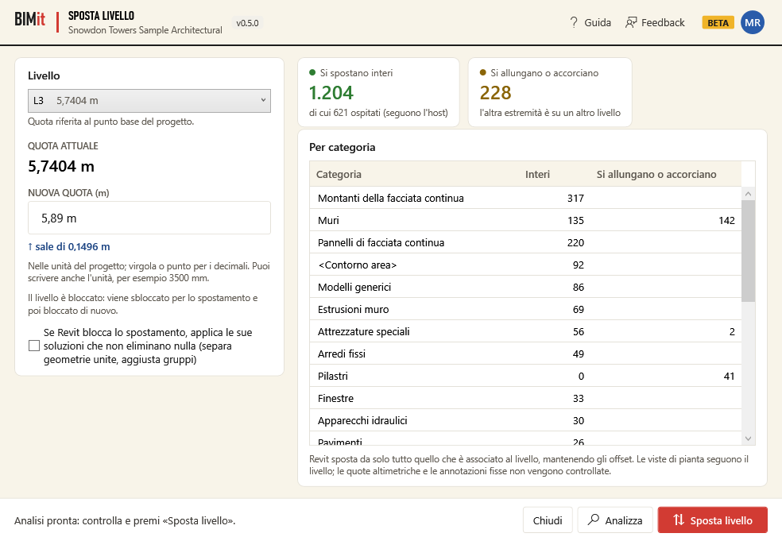

**Prima di iniziare**

- Serve un progetto con almeno un livello. In un file di famiglia il comando non parte.
- La finestra parte dal livello che hai selezionato in Revit. Se non ne hai selezionato nessuno, parte dal livello della vista attiva (per esempio una pianta) oppure dal livello più basso.
- Nei modelli condivisi sincronizza prima: se il livello è stato modificato nel modello centrale, BIMit non lo sposta.

#### A sinistra: livello e quota

| Elemento | Cosa fa |
|---|---|
| **Livello** | Il livello da spostare. L'elenco va dal più basso al più alto, con la quota di ognuno accanto al nome. |
| **Quota riferita al punto base del progetto** / **Quota riferita al punto di rilievo** | Da dove si misura la quota del livello. Dipende dal tipo del livello. La nuova quota si misura dallo stesso punto. |
| **QUOTA ATTUALE** | La quota di adesso, nelle unità del progetto. Se il formato del progetto la arrotonda, BIMit usa una precisione più fine (più decimali, oppure frazioni più piccole per piedi e pollici) quando questa la mostra esatta. Se nessuna precisione la mostra esatta, resta nel formato del progetto. Lo stesso vale per le quote nell'elenco e nella casella. |
| **NUOVA QUOTA (…)** | La quota di arrivo. Tra parentesi c'è l'unità del progetto. Quando scegli un livello, la casella contiene la sua quota attuale, già selezionata e pronta da riscrivere. Per i decimali va bene la virgola o il punto, e puoi scrivere anche l'unità (per esempio `3500 mm`): lo ricorda anche la nota sotto la casella. Con **Invio** parte *Analizza*. |
| **↑ sale di … / ↓ scende di …** | Lo spostamento, calcolato mentre scrivi. Può dire anche: *= uguale alla quota attuale*, *Scrivi la nuova quota.* (casella vuota) e *Quota non valida.* (il testo non si legge come una lunghezza). Uno spostamento piccolo non viene mai mostrato come zero: sotto la precisione più fine leggi *meno di …*. |
| **Il livello è bloccato: …** | Compare solo se il livello è bloccato. BIMit lo sblocca per spostarlo e poi lo blocca di nuovo. |
| **Se Revit blocca lo spostamento, applica le sue soluzioni che non eliminano nulla (separa geometrie unite, aggiusta gruppi)** | All'apertura non è spuntata. Se la spunti e Revit dà un errore per cui propone una soluzione che non elimina niente (per esempio *Impossibile tagliare l'elemento unito*, oppure gruppi dello stesso tipo diventati diversi), BIMit la applica come propone la finestra di Revit: separa le geometrie unite o fa correggere gli elementi a Revit (per esempio aggiusta i gruppi). Non elimina mai elementi. |

#### A destra: l'analisi

Le carte e la tabella si riempiono quando premi **Analizza**. Prima vedi **—** e il messaggio *Scegli il livello e la nuova quota, poi premi «Analizza» per vedere cosa si sposta.* Se cambi il livello o la quota, l'analisi si azzera. L'analisi mostra solo numeri: non elenca e non seleziona gli elementi.

| Elemento | Cosa fa |
|---|---|
| **Si spostano interi** | Gli elementi legati solo a questo livello. Salgono o scendono con lui e gli offset non cambiano. Nella carta, sotto il numero, leggi *con il livello, offset invariati* oppure, se ce ne sono, *di cui N ospitati (seguono l'host)*: le famiglie ospitate da un muro, un solaio o un altro elemento, che si spostano con il loro host. |
| **Si allungano o accorciano** | Gli elementi con un'estremità su questo livello e l'altra su un altro livello, per esempio un muro con la base qui e il vincolo superiore al piano sopra. Cambiano altezza. |
| **In uso da altri** | Compare solo nei modelli condivisi, e solo se ce ne sono. Sono elementi che dovrebbero spostarsi ma che un altro utente sta usando: Revit potrebbe rifiutare la modifica. |
| **Per categoria** | Una tabella con le colonne **Categoria**, **Interi** e **Si allungano o accorciano**. In cima trovi le categorie con più elementi. Clicca un'intestazione per ordinare. |
| **Nota sotto la tabella** | Revit sposta da solo tutto quello che è associato al livello, mantenendo gli offset. Le viste di pianta seguono il livello. Le quote altimetriche e le annotazioni fisse non vengono controllate. |

Se nessun elemento dipende dal livello leggi *Nessun elemento è associato a questo livello: si sposta solo il livello (con le sue viste).*

L'analisi conta solo gli elementi di modello legati al livello: tramite un parametro di livello (base, sommità, livello di riferimento, livello del locale…) oppure perché quello è il loro livello. Annotazioni, altri livelli e griglie non sono contati.

#### Piede della finestra

| Elemento | Cosa fa |
|---|---|
| **Messaggio a sinistra** | Ti dice cosa fare: *Scrivi una quota diversa da quella attuale.*, *Premi «Analizza» per vedere cosa si sposta, oppure «Sposta livello».*, *Analisi pronta: controlla e premi «Sposta livello».* Mentre BIMit analizza leggi *Analisi degli elementi del livello …* e poi, ogni 500 elementi, *Analisi: N elementi letti...*. Mentre sposta leggi *Spostamento del livello …*. Sotto scorre una barra di attesa (senza percentuale). Dopo uno spostamento riuscito il messaggio dice *Livello «…» spostato a …*. |
| **Chiudi** | Chiude la finestra. |
| **Analizza** | Legge il modello e riempie le carte e la tabella. Non modifica niente. |
| **Sposta livello** | Porta il livello alla nuova quota, dopo una conferma. È attivo solo se la nuova quota è diversa da quella attuale. Se non hai ancora premuto *Analizza*, l'analisi parte da sola. |

Mentre BIMit analizza o sposta, i pulsanti, l'elenco dei livelli e la casella della quota sono disattivati e non puoi chiudere la finestra.

#### Cosa succede quando premi Sposta livello

1. **La conferma.** La finestra *BIMit · Sposta livello* riassume l'operazione:
   - il livello, la quota di partenza, la quota di arrivo e di quanto sale o scende;
   - quanti elementi si spostano con il livello;
   - **ATTENZIONE** con il numero degli elementi che cambieranno altezza, se ce ne sono;
   - quanti elementi sono in uso da altri utenti e se il livello è bloccato, se è il caso;
   - *Un solo Ctrl+Z in Revit annulla lo spostamento.*
2. **Lo spostamento.** Se rispondi **Sì**, BIMit cambia la quota del livello in un'unica operazione. Nell'elenco *Annulla* di Revit la trovi come *BIMit: sposta livello*.
3. **Il risultato.** Un messaggio ti dice:
   - *Livello «…» spostato a …*;
   - se ci sono elementi associati: *Elementi associati al livello: N. Spostati davvero (controllo dell'ingombro): M su K verificabili.* Per saperlo BIMit confronta l'ingombro in altezza di ogni elemento prima e dopo lo spostamento. Gli elementi senza ingombro non si possono verificare e non sono contati in K;
   - se ce ne sono: *Di questi, N hanno cambiato altezza (l'altra estremità è su un altro livello).* È il numero dell'analisi (la carta **Si allungano o accorciano**), non un controllo fatto dopo lo spostamento;
   - *Revit ha risolto: …*: gli errori risolti con l'opzione «applica le sue soluzioni» (al massimo 8). Per ognuno leggi il testo dell'errore seguito da *geometrie unite separate* oppure *corretto come propone Revit (per esempio gruppi aggiustati)*, con il numero di elementi toccati;
   - *Avvisi di Revit: …*: dopo una di queste soluzioni Revit mostrerebbe i suoi avvisi in una finestra da chiudere a mano; BIMit li elenca qui (al massimo 8, ognuno con quante volte compare) e la finestra di Revit non si apre;
   - se il livello era bloccato: *è stato bloccato di nuovo* oppure *ora è sbloccato*;
   - alla fine: *Un solo Ctrl+Z in Revit annulla lo spostamento.*
4. **Poi.** La finestra resta aperta sullo stesso livello, con le quote aggiornate e l'analisi azzerata, e puoi spostare un altro livello. Per tornare a lavorare in Revit chiudila.

Quando il modello non cambia, BIMit te lo dice con uno di questi messaggi:

| Messaggio | Cosa vuol dire |
|---|---|
| **Il livello non si può modificare adesso: in uso da …** | Nei modelli condivisi: un altro utente sta usando il livello. Nel modello non cambia niente. |
| **Il livello non si può modificare adesso: modificato nel modello centrale: sincronizza prima** | Il livello è cambiato (o è stato eliminato) nel centrale. Sincronizza e riprova. |
| **Revit ha annullato lo spostamento: il modello non è stato modificato.** | Revit ha dato un errore, quindi è stato annullato tutto. Sotto trovi gli errori di Revit (al massimo 8). Se l'opzione è spenta, sotto trovi anche il suggerimento *Se Revit propone una soluzione che non elimina nulla (geometrie unite, gruppi), attiva «applica le sue soluzioni» e riprova.* |
| **Spostamento non riuscito: il modello non è stato modificato.** | Un problema imprevisto. Sotto c'è il dettaglio. |
| **Analisi non riuscita: …** | Un problema imprevisto durante la lettura del modello. Sotto c'è il dettaglio. Se l'analisi era partita da **Sposta livello**, il livello non viene spostato. |

#### Da sapere

- **BIMit cambia solo la quota del livello.** Il resto lo sposta Revit secondo i vincoli di ogni elemento, e gli offset non cambiano. Gli altri livelli restano dove sono: per questo gli elementi legati anche a un altro livello si allungano o si accorciano.
- **Un solo Ctrl+Z** in Revit annulla tutto lo spostamento, compreso lo sblocco e il nuovo blocco del livello.
- **Se un errore non si risolve, non cambia niente.** Basta un errore di Revit non risolto per annullare tutta l'operazione e lasciare il modello com'era. Con l'opzione «applica le sue soluzioni che non eliminano nulla» spuntata, BIMit prima prova a risolvere l'errore senza eliminare niente (vedi il punto sotto). Gli avvisi invece Revit li mostra come sempre, e lo spostamento resta.
- **L'opzione «applica le sue soluzioni che non eliminano nulla» non elimina mai elementi.** Revit risolve un errore solo se può farlo separando le geometrie unite o correggendo gli elementi (per esempio aggiustando i gruppi). Se anche un solo errore non si risolve così, viene annullato tutto.
- **Il livello bloccato** resta bloccato: BIMit lo sblocca e lo blocca di nuovo nella stessa operazione.
- **Quote altimetriche e annotazioni fisse** non vengono controllate: dopo lo spostamento guardale tu.
- **La quota già scritta nella casella non sposta niente.** A volte la quota proposta resta arrotondata, perché nessuna precisione la mostra esatta. Anche così, se lasci o riscrivi la quota proposta, il livello non si sposta nemmeno del residuo. Una quota diversa invece vale così come la scrivi.
- **La quota si misura sempre dal punto del livello** (punto base del progetto o punto di rilievo, come dice la riga sotto l'elenco **Livello**).
- **Un elemento che non si riesce a leggere** viene saltato e l'analisi va avanti.
- **Modelli condivisi.** BIMit controlla il livello prima di toccarlo: se un altro utente lo sta usando, o se è cambiato nel centrale, non lo sposta. Gli elementi in uso da altri li trovi nella carta **In uso da altri**. Se Revit rifiuta di modificarli, viene annullato tutto.
- **Nessun file.** Lo strumento non crea file e non salva impostazioni. Solo in caso di errore imprevisto scrive nel registro tecnico di BIMit una voce con il dettaglio tecnico dell'errore. L'opzione «applica le sue soluzioni che non eliminano nulla» si spegne ogni volta che riapri la finestra.

### Esporta per IA

Salva il modello in tabelle CSV, con un indice (`00_INDEX.md`) che le spiega, da dare a un
assistente IA. L'assistente legge i file invece di interrogare Revit elemento per elemento e ti
risponde su categorie, famiglie, tipi, elementi, parametri, livelli, locali, workset, collegamenti,
materiali, viste e avvisi. Si apre con il pulsante **Esporta per IA** del pannello **Modello**
nella scheda BIMit. BIMit legge soltanto: il modello non viene modificato.

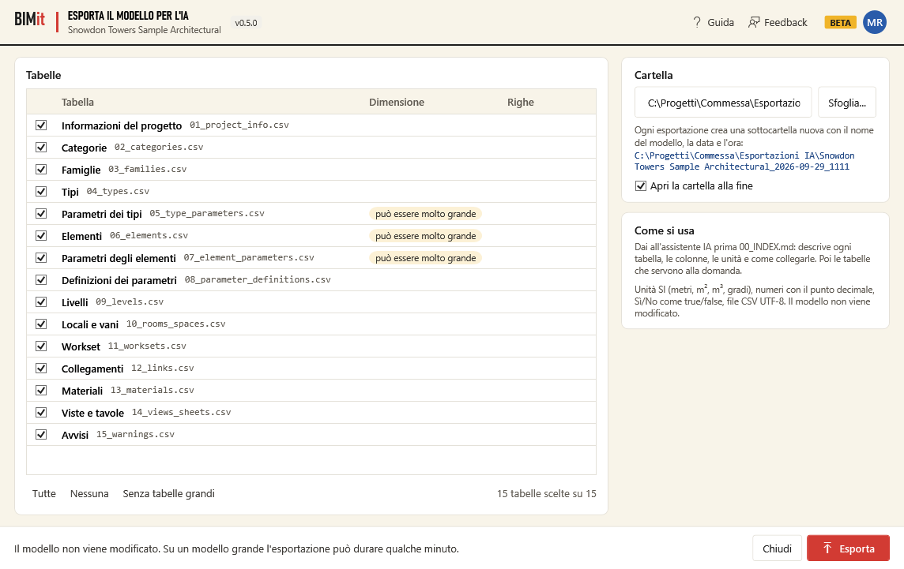

#### Prima di iniziare

- Apri un progetto (`.rvt`). Se è aperta una famiglia BIMit te lo dice (*Apri un progetto (.rvt)…*)
  e non apre la finestra.
- In un modello condiviso apri i workset che ti servono. Revit non carica gli elementi dei workset
  chiusi, quindi questi elementi non finiscono nelle tabelle. Mentre la finestra è aperta Revit è
  bloccato: apri i workset prima di aprirla (o chiudila, apri i workset e riaprila).

#### A sinistra: le tabelle

Le 15 tabelle del modello, una per riga. La prima volta sono spuntate tutte. Poi BIMit ricorda la
tua scelta.

| Elemento | Cosa fa |
|---|---|
| **Casella a sinistra di ogni riga** | Sceglie la tabella da esportare. Con più righe evidenziate (Ctrl o Shift), **Spazio** le spunta o le toglie tutte. |
| **Tabella** | Il nome della tabella e il suo file (per esempio `06_elements.csv`). Passa il mouse sul nome della tabella o del file per vedere cosa contiene. |
| **Dimensione** | *può essere molto grande*, evidenziato, per **Parametri dei tipi**, **Elementi** e **Parametri degli elementi**. Su un modello grande hanno centinaia di migliaia di righe. **Parametri degli elementi** arriva anche a milioni. |
| **Righe** | È vuota prima di esportare. Dopo: quante righe sono state scritte, *(parziale)* se la tabella non è finita, *non esportata* se hai interrotto prima che iniziasse. |
| **Tutte · Nessuna** | Spunta o toglie tutte le tabelle. |
| **Senza tabelle grandi** | Spunta tutte le tabelle, **Elementi** compresa, e toglie la spunta a **Parametri dei tipi** e **Parametri degli elementi**. |
| **N tabelle scelte su 15** | Il conteggio, sotto l'elenco, a destra dei pulsanti **Tutte · Nessuna · Senza tabelle grandi**. |

#### A destra: la cartella

| Elemento | Cosa fa |
|---|---|
| **Cartella** | Dove salvare. Puoi scrivere o incollare il percorso, anche con le virgolette di *Copia come percorso*. La prima volta è *Documenti\BIMit\Esportazioni IA*. |
| **Sfoglia...** | Sceglie la cartella. Entra nella cartella e premi **Salva**: il nome *Esporta qui* non conta. |
| **Percorso sotto la cartella** | Il percorso completo della sottocartella: nome del modello, data e ora, per esempio `…\Esportazioni IA\Edificio A_2026-09-28_1432`. Dal nome del modello BIMit toglie `.rvt` e tiene al massimo 80 caratteri. I caratteri diversi da lettere, cifre, spazio, `-`, `.` e `_` (anche `'` `(` `)` `&`) diventano `_`: `Edificio (A)` diventa `Edificio _A_`. L'ora è quella in cui premi **Esporta**: se la finestra resta aperta a lungo, l'anteprima può mostrare un'ora precedente. Se esiste già, all'esportazione si aggiunge `_2`, `_3`… In Revit 2022, 2023 e 2024, se il percorso contiene caratteri come `<` `>` `\|` compare *Percorso della cartella non valido.* Negli altri casi l'errore arriva quando premi **Esporta** (*Impossibile usare la cartella*). |
| **Apri la cartella alla fine** | Apre la sottocartella quando l'esportazione finisce, anche se l'hai interrotta. È spuntata la prima volta. Puoi cambiarla anche mentre l'esportazione è in corso. |
| **Come si usa** | Il promemoria: all'assistente dai prima `00_INDEX.md`, poi le tabelle che servono alla domanda. |
| **Ultima esportazione** | Compare dopo un'esportazione: il riepilogo, la sottocartella e il pulsante **Apri la cartella**. |

#### In basso

| Elemento | Cosa fa |
|---|---|
| **Messaggio a sinistra** | *Scegli almeno una tabella.* oppure *Il modello non viene modificato. Su un modello grande l'esportazione può durare qualche minuto.* Durante l'esportazione mostra la fase (*Lettura del modello*, *Tabella …*, *Tipi*, *Elementi*, *Viste e tavole*, *Avvisi*), il conteggio (*Elementi 12.000 / 85.000*) e la barra di avanzamento. |
| **Chiudi** | Chiude e ricorda le impostazioni. È disattivato durante l'esportazione. |
| **Esporta** | Avvia l'esportazione. È disattivato se non hai scelto nessuna tabella. Durante l'esportazione diventa **Interrompi**: dopo il clic compare *Interruzione...* e BIMit si ferma poco dopo. |

#### Quando premi Esporta

1. BIMit crea una sottocartella nuova nella **Cartella**. Se esiste già (due esportazioni nello
   stesso minuto) aggiunge `_2`, `_3`… Non sovrascrive mai un'esportazione precedente.
2. Legge il modello una volta e scrive le tabelle scelte, una dopo l'altra. Finché lavora l'elenco
   delle tabelle e il campo **Cartella** sono bloccati e non puoi chiudere la finestra. **Tutte**,
   **Nessuna**, **Senza tabelle grandi** e **Sfoglia...** restano attivi, ma valgono solo per la
   prossima esportazione. **Sfoglia...** mette anche in pausa l'esportazione finché non chiudi la
   finestra di scelta.
3. Alla fine scrive `00_INDEX.md`. Lo scrive anche se interrompi o se qualche tabella ha avuto
   errori. Non lo scrive se l'esportazione non riesce (*Esportazione non riuscita*).
4. Il messaggio in basso e il riquadro **Ultima esportazione** dicono *Fatto: N righe in N tabelle
   (durata).* e la colonna **Righe** si riempie. Se **Apri la cartella alla fine** è spuntata, la
   cartella si apre.

Se interrompi, o se un tipo, un elemento o una tabella non riesce, alla fine la finestra
*BIMit · Esporta per IA* mostra il riepilogo, la cartella e i primi errori. Gli ultimi tre messaggi
della tabella compaiono invece in un avviso *BIMit*:

| Messaggio | Cosa vuol dire |
|---|---|
| *Interrotta: esportazione INCOMPLETA.* | Le tabelle rimaste a metà sono *(parziale)*. Quelle mai iniziate sono *non esportata*. L'indice lo scrive in testa (*INCOMPLETO*) ed elenca le tabelle mancanti in *Non esportate*. **Categorie** e **Famiglie** vengono scritte comunque, segnate parziali se la lettura dei tipi non era finita. |
| *tipo … saltato* / *elemento … saltato* | Revit non è riuscito a leggere quel tipo o quell'elemento, e BIMit lo ha lasciato fuori. Il messaggio mostra i primi cinque. La tabella non è segnata *(parziale)*: nell'indice risulta completa. |
| *`nome_tabella.csv`: …* | Una tabella ha avuto un errore. Se era già iniziata, è segnata *(parziale)*. Se BIMit non è riuscito a creare il file, la tabella manca: la colonna **Righe** resta vuota e l'indice non la nomina. |
| *Scegli la cartella delle esportazioni.* | Il campo **Cartella** è vuoto: scrivi un percorso o usa **Sfoglia...**. |
| *Impossibile usare la cartella* | BIMit non riesce a creare la cartella: scegline un'altra. Il messaggio arriva prima di iniziare e non viene scritto niente. |
| *Esportazione non riuscita* | L'esportazione si è fermata per un errore. Il messaggio indica la sottocartella: può contenere tabelle incomplete, senza `00_INDEX.md`. La colonna **Righe** resta vuota, **Ultima esportazione** non si aggiorna e la cartella non si apre. |

#### Cosa trovi nella cartella

| Tabella | File | Cosa contiene |
|---|---|---|
| — | `00_INDEX.md` | L'indice per l'assistente IA: modello, versione di Revit, data, numero di istanze e tipi, le convenzioni (numeri, unità, come collegare le tabelle). Poi, per ogni tabella esportata, le righe (con *(parziale)* se è incompleta), la descrizione e le colonne; poi le tabelle non esportate per l'interruzione e l'ordine in cui leggerle. |
| **Informazioni del progetto** | `01_project_info.csv` | Titolo, percorso, versione di Revit, data, se il modello è condiviso, numero di istanze e tipi. Poi i campi di *Informazioni progetto*: quelli di testo solo se compilati, quelli numerici e *Sì/No* sempre. |
| **Categorie** | `02_categories.csv` | Una riga per categoria, con istanze, tipi e famiglie. `bic` è il nome interno (es. `OST_Walls`), uguale in ogni lingua. |
| **Famiglie** | `03_families.csv` | Una riga per famiglia: caricabile, modello locale o di sistema, con tipi e istanze. |
| **Tipi** | `04_types.csv` | Una riga per tipo, con la famiglia e il numero di istanze. |
| **Parametri dei tipi** | `05_type_parameters.csv` | Una riga per ogni parametro di tipo. I parametri di testo e quelli che puntano a un elemento ci sono solo se hanno un valore. Quelli numerici e *Sì/No* ci sono sempre: `0` o `false` se nessuno li ha compilati. |
| **Elementi** | `06_elements.csv` | Una riga per ogni elemento che ha una categoria, non solo quelli di modello (vedi *Da sapere*): categoria, famiglia, tipo, contrassegno, livello, workset, opzione di progetto, fasi, gruppo, host, posizione (`x`, `y`, `z`), lunghezza, area, volume e ingombro (`bbox_*`). |
| **Parametri degli elementi** | `07_element_parameters.csv` | Una riga per ogni parametro di istanza, con le stesse regole di **Parametri dei tipi**. |
| **Definizioni dei parametri** | `08_parameter_definitions.csv` | I parametri condivisi, di progetto e globali: GUID, tipo di dato, gruppo, istanza o tipo, categorie associate. |
| **Livelli** | `09_levels.csv` | I livelli in ordine di quota, con la quota come la mostra Revit e il riferimento (punto base di progetto o punto di rilievo). |
| **Locali e vani** | `10_rooms_spaces.csv` | Locali e vani MEP: numero, nome, livello, area, volume, perimetro. Dice anche se sono posizionati e se sono chiusi. |
| **Workset** | `11_worksets.csv` | Solo i workset utente: se sono aperti, se sono modificabili, se sono il workset predefinito e chi ne è il proprietario (`owner`). Chi ha in prestito singoli elementi non c'è. È vuota se il modello non è condiviso. |
| **Collegamenti** | `12_links.csv` | Modelli Revit collegati, file CAD collegati o importati, nuvole di punti: percorso, se sono caricati, se sono bloccati. |
| **Materiali** | `13_materials.csv` | Nome, classe e categoria di ogni materiale. |
| **Viste e tavole** | `14_views_sheets.csv` | Viste, abachi, legende, modelli di vista e tavole: tipo, numero della tavola (per una vista, le tavole in cui è posizionata), scala, disciplina. |
| **Avvisi** | `15_warnings.csv` | Gli avvisi di Revit, con la gravità e gli elementi coinvolti. |

Il formato dei file:

- CSV separati da virgola, in UTF-8. La prima riga contiene i nomi delle colonne, in inglese e
  uguali in ogni lingua. I nomi di categorie e parametri sono nella lingua di Revit.
- I numeri hanno il punto decimale e nessun separatore delle migliaia. I valori *Sì/No* sono
  `true` e `false`. Una cella vuota vuol dire *non impostato*, non zero. Nei parametri, però, un
  numero o un *Sì/No* mai compilato è scritto `0` o `false`.
- Le unità sono SI: metri, m², m³, gradi (colonne `_m`, `_m2`, `_m3`). Nei parametri la colonna
  `unit` dice l'unità. Se `unit` è vuota su una riga con `storage` = `Double` (portate, forze,
  pendenze…), il valore è nelle unità interne di Revit: in quel caso usa `value_text`, cioè il
  valore come lo mostra Revit. I numeri interi (`storage` = `Integer`) sono scritti così come sono; se Revit li mostra come testo (per esempio un elenco di opzioni), `value_text` riporta quel testo. Anche i parametri *Sì/No* hanno `storage` = `Integer`, ma sono scritti `true` o `false`.
- Un parametro che punta a un altro elemento (materiale, livello, fase…) è scritto `Nome [id]`.

#### Da sapere

- **Il modello non viene toccato.** BIMit legge soltanto e non apre nessuna transazione. Non c'è
  niente da annullare con Ctrl+Z e niente da salvare. Funziona anche su un modello aperto in sola
  lettura.
- **Modelli condivisi.** BIMit non prende in prestito elementi e non sincronizza. La colonna
  `workset` di **Elementi** e la tabella **Workset** si riempiono solo se il modello è condiviso.
  Gli elementi dei workset chiusi non ci sono.
- **Modelli collegati.** Trovi solo il loro elenco in **Collegamenti**, non il loro contenuto. Per
  analizzare un modello collegato, aprilo ed esportalo.
- **Coordinate.** `x`, `y`, `z` e `bbox_*` sono nelle coordinate interne del progetto, non in quelle
  condivise.
- **Elementi** contiene tutti gli elementi che hanno una categoria, non solo quelli di modello:
  anche annotazioni (quote, etichette, testi…), viste, tavole, livelli, griglie, materiali… La
  colonna `view_specific` distingue gli elementi di una sola vista e `owner_view` dice in quale
  vista si trovano. Anche il numero di istanze in **Informazioni del progetto** e **Categorie** li
  comprende.
- Dei parametri di testo e di quelli che puntano a un elemento si esportano solo quelli che hanno
  un valore. I parametri numerici e *Sì/No* si esportano sempre: se nessuno li ha compilati sono
  `0` o `false`, e nei file non si distinguono da uno zero o da un *No* scritto apposta.
- Su un modello grande l'esportazione dura qualche minuto e i file sono molto grandi. Se
  all'assistente non servono tutti i parametri, usa **Senza tabelle grandi**.
- **I file restano sul tuo PC.** BIMit non li manda a nessun assistente: scegli tu cosa dare e a
  chi. I file contengono nomi, percorsi e dati del progetto: prima di condividerli, controlla di
  poterlo fare.
- Con Windows in italiano, se apri questi CSV con un doppio clic Excel mette tutto in una sola
  colonna. Aprili con *Dati → Da testo/CSV*.
- BIMit ricorda la cartella, le tabelle scelte e **Apri la cartella alla fine** per il tuo utente.

---

## 14. MEP: manicotti, locali → spazi

Il pannello **MEP** ha due pulsanti per i modelli degli impianti: *Manicotti* e *Locali → spazi*.

### Manicotti

Inserisce un manicotto (o una forometria) in ogni punto in cui tubazioni, condotti, tubi protettivi e
passerelle portacavi attraversano muri, solai e strutture. Cerca nel modello corrente e nei modelli
collegati. Ogni manicotto è un *Modello generico* con dimensione, codice e quota già compilati. Si apre
con il pulsante **Manicotti** del pannello **MEP** della scheda BIMit. La finestra si chiama
**Manicotti e forometrie**.

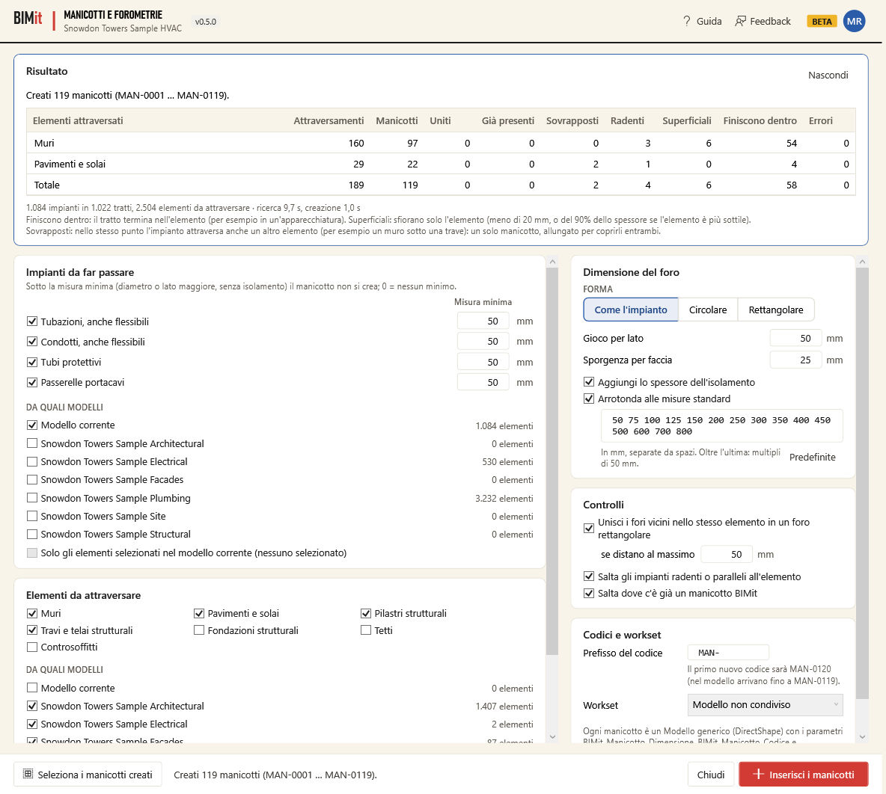

#### Prima di iniziare

- Apri un **progetto**: nelle famiglie il comando non parte.
- I modelli collegati compaiono solo se sono **caricati**.
- Vuoi lavorare solo su alcuni impianti del modello corrente? **Selezionali in Revit prima** di premere
  **Manicotti**, poi nella finestra spunta **Solo gli elementi selezionati nel modello corrente**.
  Se non la spunti, BIMit usa tutti gli impianti del modello corrente.

#### Impianti da far passare

| Elemento | Cosa fa |
|---|---|
| **Tubazioni, anche flessibili**, **Condotti, anche flessibili**, **Tubi protettivi**, **Passerelle portacavi** | Le categorie di impianti in cui cercare gli attraversamenti. La prima volta sono spuntate tutte e quattro. |
| **Misura minima** (mm) | Una per categoria. Sotto questa misura il manicotto non si crea. Conta il diametro esterno o il lato maggiore, senza isolamento. Per tubazioni e tubi protettivi conta il diametro esterno, non il DN. *0* o vuoto = nessun minimo. La prima volta è 50 mm per ogni categoria: gli impianti più piccoli di 50 mm non ricevono il manicotto. Il campo è attivo solo se la categoria è spuntata. |
| **DA QUALI MODELLI** | Il **Modello corrente** e ogni modello collegato caricato, con il numero dei loro impianti. Spunta i modelli da cui prendere gli impianti. All'apertura è spuntato solo il *Modello corrente*. |
| **Solo gli elementi selezionati nel modello corrente (N)** | Usa solo gli impianti che erano selezionati quando hai aperto la finestra. All'apertura non è spuntata, anche se hai una selezione: spuntala tu. Vale solo per il *Modello corrente*: dei modelli collegati spuntati prende tutti gli impianti. È grigia (*nessuno selezionato*) se non avevi selezionato impianti. |

#### Elementi da attraversare

| Elemento | Cosa fa |
|---|---|
| **Muri**, **Pavimenti e solai**, **Pilastri strutturali**, **Travi e telai strutturali**, **Fondazioni strutturali**, **Tetti**, **Controsoffitti** | Le categorie degli elementi attraversati. La prima volta sono spuntate le prime quattro. |
| **DA QUALI MODELLI** | Il **Modello corrente** e i modelli collegati caricati, con il numero di elementi di queste categorie. All'apertura sono spuntati tutti i modelli che ne hanno. |

BIMit legge i collegamenti nella loro posizione vera, anche se sono ruotati o spostati. Se lo stesso
modello è collegato più volte, ogni copia ha la sua riga (*nome · copia 1 (id …)*).

#### Dimensione del foro

| Elemento | Cosa fa |
|---|---|
| **FORMA · Come l'impianto** | Foro tondo per tubazioni, tubi protettivi e condotti circolari. Foro rettangolare per condotti rettangolari o ovali e per passerelle. È la scelta della prima volta. |
| **FORMA · Circolare** | Sempre tondo. Per un condotto rettangolare o una passerella il cerchio passa per gli spigoli (con l'isolamento, se spuntato), più 2 × gioco. Per un condotto ovale il diametro è il lato maggiore + 2 × isolamento + 2 × gioco. |
| **FORMA · Rettangolare** | Sempre rettangolare. Per un tubo tondo il foro è quadrato. |
| **Gioco per lato** (mm) | Lo spazio libero su ogni lato, tra l'impianto (con l'isolamento, se è spuntato *Aggiungi lo spessore dell'isolamento*) e il foro. Da 0 a 1000 mm. La prima volta 50 mm. |
| **Sporgenza per faccia** (mm) | Di quanto il manicotto esce da ogni faccia dell'elemento. Da 0 a 1000 mm. La prima volta 25 mm. |
| **Aggiungi lo spessore dell'isolamento** | Il foro tiene conto dell'isolamento di tubazioni e condotti. Senza spunta il foro si misura sull'impianto senza isolamento. Spuntato la prima volta. |
| **Arrotonda alle misure standard** | Ogni lato, o il diametro, sale alla prima misura dell'elenco uguale o maggiore. Oltre l'ultima misura: multipli di 50 mm. Senza spunta il foro ha la misura esatta. Spuntato la prima volta. |
| **Elenco delle misure** | Le misure standard in mm, separate da spazi. Per i decimali usa il punto: la virgola separa le misure, come lo spazio. È attivo solo con *Arrotonda alle misure standard* spuntato. |
| **Predefinite** | Rimette l'elenco di partenza: 50 75 100 125 150 200 250 300 350 400 450 500 600 700 800. È attivo solo con *Arrotonda alle misure standard* spuntato. |

**Foro** = misura esterna dell'impianto + 2 × isolamento (se spuntato) + 2 × gioco. Se hai spuntato
*Arrotonda alle misure standard*, la misura sale alla prima dell'elenco uguale o maggiore.
**Lunghezza** = il tratto di impianto dentro l'elemento + 2 × sporgenza. La lunghezza non si arrotonda.

#### Controlli

| Elemento | Cosa fa |
|---|---|
| **Unisci i fori vicini nello stesso elemento in un foro rettangolare** | Unisce i fori dello stesso elemento che sono paralleli (entro 5°) e vicini. Il risultato è un solo foro rettangolare che li contiene tutti. L'unione vale anche a catena: se A è vicino a B e B è vicino a C, nasce un foro unico. Spuntato la prima volta. |
| **se distano al massimo** (mm) | La distanza massima tra i bordi di due fori da unire (non tra i centri). Da 0 a 2000 mm. La prima volta 50 mm. È attivo solo con *Unisci…* spuntato. |
| **Salta gli impianti radenti o paralleli all'elemento** | Salta gli impianti che corrono dentro l'elemento o lungo l'elemento, cioè con un attraversamento più lungo di 4 volte lo spessore. Non ricevono il manicotto. Spuntato la prima volta. |
| **Salta dove c'è già un manicotto BIMit** | Salta l'attraversamento se l'impianto sta già tutto dentro un manicotto o un foro unito di BIMit, anche rinominato. Se due elementi sono attraversati nello stesso punto (centri a meno di 30 mm, stessa direzione entro 5°; per esempio un muro sotto una trave), crea un solo manicotto, allungato e se serve allargato per coprirli entrambi. Senza spunta ogni attraversamento riceve il suo manicotto. Spuntato la prima volta. |

#### Codici e workset

| Elemento | Cosa fa |
|---|---|
| **Prefisso del codice** | L'inizio del codice di ogni manicotto (la prima volta *MAN-*). Segue un numero di 4 cifre. La numerazione riparte dopo il numero più alto con lo stesso prefisso già presente nel modello. |
| **Il primo nuovo codice sarà …** | Sotto il prefisso. Mostra il primo codice che verrà usato e, se ce ne sono, il codice più alto con lo stesso prefisso già presente nel modello (*… nel modello arrivano fino a MAN-0040*). Si aggiorna mentre scrivi il prefisso. |
| **Workset** | Il workset dei nuovi manicotti. Parte dal workset attivo, segnato *(attivo)*. Se il modello non è condiviso, il campo è grigio (*Modello non condiviso*). |

Ogni manicotto è un **Modello generico** (DirectShape). Ha tre parametri di istanza di testo, nel
gruppo *Dati*:

| Parametro | Cosa contiene |
|---|---|
| **BIMit_Manicotto_Dimensione** | `Ø150 mm` oppure `400×300 mm` (larghezza × altezza). |
| **BIMit_Manicotto_Codice** | `MAN-0001`. |
| **BIMit_Manicotto_Quota** | `+1250 mm (Livello 1)`. È il punto più basso del manicotto: per un manicotto orizzontale il fondo del foro, per uno verticale (in un solaio) l'estremità inferiore, sporgenza compresa. Si misura dal livello più vicino sotto di lui. Se il manicotto è sotto tutti i livelli, si misura dal livello più basso. |

Il nome dell'elemento dice forma, misura e lunghezza in mm: *Manicotto Ø150 L300*,
*Manicotto 400×300 L300* oppure, per un foro unito, *Foro unito 400×300 L300*.

#### Piede della finestra

| Elemento | Cosa fa |
|---|---|
| **Messaggio a sinistra** | Prima di partire dice quanti modelli hai scelto (*Impianti da 1 modello, elementi da 3 modelli.*) o cosa manca. Durante il lavoro mostra la fase in corso (*tratto 26 di 800*, *Creazione 11 di 95*) con la barra di avanzamento. Alla fine riporta il risultato. |
| **Seleziona i manicotti creati** | Compare dopo un inserimento che ha creato manicotti. Chiude la finestra, seleziona in Revit i manicotti appena creati e li mostra nella vista. |
| **Chiudi** | Chiude la finestra. Durante il lavoro è bloccato. |
| **Inserisci i manicotti** | Cerca gli attraversamenti e crea i manicotti. Durante il lavoro diventa **Interrompi**. |

#### Quando premi Inserisci i manicotti

1. **Controllo dei valori.** Se un valore non va bene, BIMit te lo dice e non parte. Succede con un
   numero non valido, un valore fuori dai limiti, un elenco delle misure non valido (con *Arrotonda*
   spuntato), nessuna categoria o nessun modello scelto. Nei campi in mm puoi usare la virgola o il
   punto (nell'elenco delle misure solo il punto). Un campo vuoto vale 0.
2. **Ricerca.** BIMit legge i manicotti BIMit già presenti, gli elementi da attraversare e gli
   impianti. In questa fase non modifica niente. I pezzi dritti in linea formano un solo **tratto**: sia
   quando li unisce un raccordo o un accessorio in linea (giunto, valvola, tee dritto), sia quando si
   toccano soltanto. Così un tubo spezzato dentro un muro dà un solo attraversamento, non due. BIMit
   usa tutta la geometria dell'elemento (strati, più pezzi). Ogni attraversamento dello stesso elemento
   ha il suo foro, per esempio nei due lati di un muro a L.
3. **Creazione.** BIMit unisce i fori vicini e dà i codici dal basso verso l'alto. Poi crea i
   parametri che mancano e i manicotti. Non chiede conferma. Chiude da solo gli avvisi di Revit.
4. **Risultato.** Il riquadro **Risultato** compare in alto nella finestra. **Nascondi** lo chiude.

**Interrompi** si ferma dopo il passo in corso. Durante il lavoro il resto della finestra e **Chiudi**
sono bloccati. Anche la X della finestra, durante il lavoro, interrompe, ma la finestra resta aperta.
Se interrompi, nessun manicotto resta nel modello: quelli già creati e i parametri nuovi vengono
annullati.

#### Il risultato

Il messaggio in alto:

| Messaggio | Significato |
|---|---|
| **Creati N manicotti (MAN-0001 … MAN-0040)** | Il numero di manicotti e il primo e l'ultimo codice. Se ci sono fori uniti, dice quanti sono e quanti manicotti vicini sostituiscono. Nei modelli condivisi indica anche il workset. |
| **Nessun nuovo manicotto da creare.** | Nessun attraversamento da coprire: non ce ne sono, sono già coperti o sono stati saltati. |
| **Nessun impianto trovato nelle categorie e nei modelli scelti.** | Controlla le categorie e *DA QUALI MODELLI*. |
| **Interrotto: nessun manicotto creato, il modello non è stato modificato.** | Hai premuto *Interrompi*. |
| **Il modello non è stato modificato.** | La creazione non è riuscita ed è stata annullata. Il motivo è nelle note. |

La tabella ha una riga per ogni categoria di elementi attraversati in cui BIMit ha trovato
attraversamenti. Con più categorie, l'ultima riga è il **Totale**.

| Colonna | Significato |
|---|---|
| **Elementi attraversati** | La categoria (*Muri*, *Pavimenti e solai*…). |
| **Attraversamenti** | Quanti attraversamenti BIMit ha trovato. |
| **Manicotti** | Quanti manicotti ha creato. Un foro unito conta uno. |
| **Uniti** | Quanti attraversamenti sono finiti in un foro unito. |
| **Già presenti** | Attraversamenti già dentro un manicotto BIMit: saltati. Solo con *Salta dove c'è già un manicotto BIMit* spuntato; senza, resta a 0. |
| **Sovrapposti** | Nello stesso punto l'impianto attraversa anche un altro elemento. Un solo manicotto, allungato e se serve allargato, copre entrambi. Solo con *Salta dove c'è già un manicotto BIMit* spuntato; senza, resta a 0. |
| **Radenti** | Impianti che corrono dentro o lungo l'elemento: saltati. |
| **Superficiali** | Impianti che sfiorano appena l'elemento: saltati. Il tratto dentro è sotto 20 mm, o sotto il 90% dello spessore se l'elemento è più sottile. |
| **Finiscono dentro** | Il tratto termina nell'elemento, per esempio in un'apparecchiatura: saltati. |
| **Errori** | Attraversamenti che BIMit non è riuscito a calcolare o manicotti non creati. Il motivo è nelle note. |

Sotto la tabella trovi le note:

- quanti impianti, tratti ed elementi da attraversare sono stati letti, e i secondi di ricerca e di
  creazione;
- quanti impianti erano sotto la misura minima e quanti erano senza asse (saltati);
- quanti manicotti BIMit c'erano già nel modello;
- gli impianti che escono da un manicotto BIMit esistente, perché l'impianto è stato spostato o il
  manicotto è troppo piccolo. Per questi BIMit crea un nuovo manicotto. Del vecchio ti dice se
  contiene ancora altri attraversamenti (va tenuto) oppure se non contiene più nessuno degli impianti
  scelti. In quel caso controllalo ed eliminalo solo se non serve più a nessun impianto. Questa nota
  compare solo con *Salta dove c'è già un manicotto BIMit* spuntato;
- una spiegazione di *Finiscono dentro* e *Superficiali* (sempre) e di *Sovrapposti* (se ce ne sono);
- fino a 8 altre note, per esempio errori o parametri non scritti. Le altre sono nel log
  (*Account* → **Cartella dei log**). BIMit annota al massimo circa 30 note: oltre, gli errori non
  finiscono neanche nel log.

#### Da sapere

- **Un solo Ctrl+Z** in Revit annulla tutto l'inserimento, cioè parametri e manicotti. Nella cronologia
  dei comandi l'operazione si chiama *BIMit: manicotti*.
- **Cosa resta intatto.** Impianti, muri, solai, strutture e manicotti già presenti non vengono
  modificati né cancellati. I modelli collegati vengono solo letti: i manicotti si creano sempre nel
  modello corrente. Nel progetto cambiano solo i parametri dei manicotti (vedi **Parametri**).
- **I manicotti vecchi non si cancellano mai da soli**, nemmeno quando un impianto si è spostato. Un
  foro unito può servire anche ad altri impianti. BIMit te li segnala nelle note.
- BIMit riconosce i suoi manicotti da un contrassegno interno, non dal nome: puoi rinominarli. Riconosce
  solo quelli del modello corrente, non quelli dei modelli collegati.
- **Codici.** La numerazione riparte dopo il numero più alto con lo stesso prefisso (maiuscole e
  minuscole non contano) scritto in *BIMit_Manicotto_Codice* nei Modelli generici del modello. Così due
  inserimenti non danno mai lo stesso codice. Se un manicotto non si crea, il suo codice non viene usato
  e nella numerazione resta un salto.
- **Parametri.** Se mancano, BIMit crea i tre parametri da un suo file di parametri condivisi, con GUID
  fissi uguali in tutti i progetti. Il file è `BIMit_SharedParameters.txt` in `%LOCALAPPDATA%\BIMit`.
  L'impostazione del file dei parametri condivisi di Revit non cambia. Se nel progetto c'è già un
  parametro con lo stesso nome che è di tipo, o non è di testo, BIMit non lo scrive e lo dice nelle
  note. Se esiste ma non è assegnato ai Modelli generici, BIMit aggiunge quella categoria e lo mette nel
  gruppo *Dati*.
- **Worksharing.** I nuovi manicotti vanno nel workset scelto in **Workset**, di solito quello attivo.
- **Unità.** Tutte le misure della finestra sono in **mm**, qualunque siano le unità del progetto.
- BIMit legge solo i tratti di tubazioni, condotti, tubi protettivi e passerelle. Raccordi, accessori e
  apparecchiature non ricevono un manicotto proprio.
- Se BIMit non riesce a leggere la misura di un impianto, il foro diventa Ø100 mm + 2 × gioco (un
  quadrato della stessa misura con *FORMA · Rettangolare*), arrotondato alle misure standard se
  *Arrotonda* è spuntato. La misura minima per questi impianti non si applica.
- Se BIMit non riesce a leggere la geometria di un elemento da attraversare, lo salta senza avvisare:
  non compare nemmeno tra gli *Errori*.
- **Varianti di progetto.** BIMit legge il modello principale e la variante principale. Le varianti
  secondarie sono ignorate.
- **Selezione.** *Solo gli elementi selezionati…* usa la selezione presente quando hai aperto la
  finestra, e solo se la spunti. Per cambiarla chiudi la finestra, seleziona e riapri.
- **Le tue scelte restano.** BIMit le salva in `%LOCALAPPDATA%\BIMit\Mep_Manicotti.json` ogni volta
  che premi **Inserisci i manicotti** e i valori sono validi, e te le ripropone la volta dopo, in
  qualunque progetto. Non salva i modelli spuntati, *Solo gli elementi selezionati* e il workset.
- Non viene scritto nessun file di report. Il risultato resta nella finestra e le note vanno nel log.

### Locali → spazi

Disegna nel modello corrente le **linee di separazione spazi** ricalcando il contorno dei locali di un modello collegato, livello per livello. Servono a delimitare gli spazi MEP come i locali architettonici, senza ridisegnarli a mano. Le linee già presenti non vengono ripetute, anche se sono disegnate a mano o in più pezzi. Si apre con il pulsante **Locali → spazi** del pannello **MEP**, nella scheda BIMit.

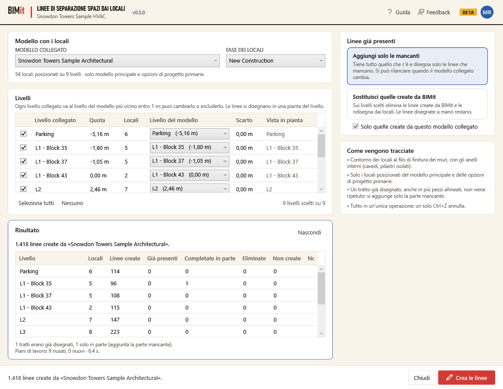

**Prima di iniziare**

- Apri il progetto (non una famiglia) in cui vuoi le linee.
- Il modello con i locali deve essere **collegato e caricato**. Un collegamento scaricato o in un workset chiuso non compare. Se non ce n'è nessuno, BIMit te lo dice e non apre la finestra.
- Il modello corrente deve avere i livelli (se non ne ha, BIMit te lo dice e non apre la finestra) e, per ogni livello che usi, una **pianta**: le linee si disegnano lì.

**Modello con i locali**

| Elemento | Cosa fa |
|---|---|
| **MODELLO COLLEGATO** | Il modello da cui leggere i locali. L'elenco contiene tutti i modelli Revit collegati e caricati, in ordine alfabetico. Se lo stesso file è collegato più volte, ogni copia ha la sua voce (*copia 1 (id …)*, *copia 2 …*). |
| **FASE DEI LOCALI** | Prende solo i locali di questa fase. All'apertura, e ogni volta che cambi modello collegato, è scelta l'ultima fase del modello collegato. *(tutte le fasi)* li prende tutti. |
| **Messaggio sotto** | Quanti locali posizionati ci sono e su quanti livelli, quanti sono *senza livello, saltati* e il promemoria *solo modello principale e opzioni di progetto primarie*. Se non ce ne sono: *Nessun locale posizionato in questa fase*, con il numero dei locali senza livello se ce ne sono. Se i locali non si possono leggere: *Impossibile leggere i locali: …* e la tabella dei livelli resta vuota. |

**Livelli**

Ogni livello del modello collegato che ha dei locali occupa una riga, in ordine di quota. Clicca un'intestazione per ordinare (non quella della colonna delle caselle). Se cambi modello collegato o fase, la tabella si ricalcola: le spunte e i livelli scelti a mano tornano alla proposta di BIMit.

| Elemento | Cosa fa |
|---|---|
| **Casella a sinistra** | Includi o escludi il livello. Quando la tabella si carica sono spuntati i livelli che hanno un livello del modello entro 1 m. |
| **Livello collegato** | Il nome del livello nel modello collegato. |
| **Quota** | La sua quota nel modello corrente, in metri. Tiene conto di come è posizionato il collegamento. È misurata dall'origine interna del modello: può differire da quella che Revit mostra sul livello se i livelli sono quotati dal punto di rilievo o da un punto base di progetto spostato in altezza. |
| **Locali** | Quanti locali ha. |
| **Livello del modello** | Il livello del modello corrente su cui vanno le linee, con la sua quota (misurata come la *Quota*). BIMit propone il più vicino e puoi sceglierne un altro. Se nessun livello è entro 1 m, propone comunque il più vicino ma lascia la riga senza spunta. Se due livelli collegati vanno sullo stesso livello, i loro locali si sommano. |
| **Scarto** | La distanza in verticale tra i due livelli. È in rosso se supera 1 m. |
| **Vista in pianta** | La pianta in cui BIMit disegna le linee: una pianta dei pavimenti del livello o, se manca, una pianta dei controsoffitti o strutturale (mai una pianta delle aree). Se non ce n'è nessuna, compare in rosso *nessuna pianta: livello saltato*. |
| **Seleziona tutti** | Spunta i livelli con uno scarto di 1 m al massimo e toglie la spunta agli altri. |
| **Nessuno** | Toglie tutte le spunte. |
| **N livelli scelti su M** | Il conteggio, in basso a destra. |

**Linee già presenti** (a destra)

| Elemento | Cosa fa |
|---|---|
| **Aggiungi solo le mancanti** | È la scelta all'apertura. Non elimina niente e disegna solo le linee che mancano. Puoi rilanciarlo quando il modello collegato cambia. |
| **Sostituisci quelle create da BIMit** | Sui livelli scelti elimina le linee create da BIMit e le ridisegna dai locali. Le linee disegnate a mano restano. |
| **Solo quelle create da questo modello collegato** | Attiva solo con *Sostituisci* e spuntata all'inizio. Elimina solo le linee BIMit fatte da questo collegamento. Togli la spunta per eliminare anche quelle fatte da altri collegamenti. |

Il riquadro **Come vengono tracciate** è solo un promemoria: trovi i dettagli qui sotto.

**Piede della finestra**

| Elemento | Cosa fa |
|---|---|
| **Messaggio a sinistra** | Prima di partire dice cosa verrà fatto (*N locali da tracciare su M livelli del modello*) oppure *Scegli almeno un livello*. Durante il lavoro mostra il livello in corso e il numero del locale, contato su tutti i livelli e aggiornato ogni 5 locali (*Piano terra · locale 121 di 850*), poi *Conferma...*. Alla fine mostra la prima riga del risultato. |
| **Barra di avanzamento** | Compare durante il lavoro. |
| **Chiudi** | Chiude. Durante il lavoro è disattivato, come il resto della finestra (modello collegato, fase, livelli, modalità, risultato). Restano attivi **Interrompi**, la X della finestra e i pulsanti dell'intestazione in alto, come **Guida** e **Feedback**. |
| **Crea le linee** | Parte. È disattivato se non hai scelto nessun livello. Durante il lavoro diventa **Interrompi**: annulla tutto e il modello non viene modificato (il messaggio dice *Interruzione in corso...* finché BIMit non si ferma). Anche la X della finestra interrompe, ma la finestra resta aperta e mostra il risultato. BIMit controlla l'interruzione ogni 5 locali: se interrompi durante gli ultimi locali o durante *Conferma...*, l'operazione si conclude comunque e il risultato lo mostra (per annullarla usa Ctrl+Z). |

**Quando premi Crea le linee**

1. Se hai spuntato un livello con **Scarto** oltre 1 m, BIMit ti elenca quei livelli con lo scarto (al massimo 10, poi «…») e chiede se continuare. Con *Sì* i loro locali vanno comunque sul livello scelto.
2. BIMit cerca la pianta di ogni livello del modello scelto. Un livello senza pianta viene saltato.
3. Con **Sostituisci** elimina prima le linee BIMit di quel livello: solo quelle di questo collegamento se *Solo quelle create da questo modello collegato* è spuntata, e mai quelle bloccate da altri utenti nel modello condiviso (vedi *Da sapere*). Su un livello saltato perché senza pianta non elimina niente.
4. Legge il contorno di ogni locale **al filo di finitura dei muri**, con gli anelli interni (cavedi, pilastri isolati). Lo porta nel modello corrente, con lo spostamento e la rotazione del collegamento, e lo appoggia alla quota del livello del modello.
5. Confronta ogni tratto con le linee di separazione spazi già presenti sul livello (entro circa 30 cm dalla sua quota e non più vicine a un altro livello del modello), anche disegnate a mano o in più pezzi allineati, e con quelle appena disegnate per i locali vicini. Disegna solo quello che manca. Le linee a un'altra altezza vengono ignorate e *Sostituisci* non le elimina.
6. Fa tutto in un'unica operazione, *BIMit: linee di separazione spazi*. Gli avvisi di Revit, per esempio sulle linee sovrapposte, si chiudono da soli e non devi cliccare niente. Quando conferma, Revit unisce le estremità delle linee vicine: può allungarle, accorciarle o inclinarle di qualche centimetro. Va bene così: BIMit ricorda su ogni sua linea il tratto per cui l'ha disegnata e al lancio successivo non la ripete. Se una linea appena disegnata diventa troppo corta per Revit, BIMit la toglie, come propone Revit. Qualsiasi altro errore di Revit annulla tutto senza aprire la finestra di Revit, con il motivo nelle note.

**Risultato**

Alla fine, sotto i livelli, compare il riquadro **Risultato**.

| Elemento | Cosa dice |
|---|---|
| **Prima riga** | *N linee create da «modello»* (*1 linea creata* se è una sola). Con *Sostituisci* aggiunge *, M linee BIMit sostituite*. Se non mancava niente: *0 linee create da «modello»*. Se hai interrotto: *Interrotto: il modello non è stato modificato.* Se un errore ha bloccato l'operazione o Revit l'ha annullata: *Il modello non è stato modificato.*, con il motivo nelle note. In questi due casi *Linee create*, *Completate in parte* ed *Eliminate* sono a 0. |
| **Livello**, **Locali** | Il livello del modello e quanti locali del modello collegato vanno su quel livello (sommati, se ci vanno più livelli collegati). |
| **Linee create** | Le linee nuove. |
| **Già presenti** | I tratti del contorno già disegnati per intero, prima del lancio oppure per un locale vicino nello stesso lancio (per esempio lungo una linea di separazione locali), che BIMit non ha ripetuto. Per questo possono essere più di 0 anche al primo lancio. |
| **Completate in parte** | I tratti che erano disegnati solo in parte, prima del lancio o per un locale vicino: BIMit ha aggiunto la parte mancante. |
| **Eliminate** | Le linee BIMit eliminate (solo con *Sostituisci*). |
| **Non create** | I tratti che non è stato possibile disegnare, per esempio perché Revit li ha rifiutati. Se c'è un messaggio d'errore, lo trovi nelle note (*livello: motivo*). |
| **Nota** | *nessuna vista in pianta* se il livello è stato saltato. |
| **Note sotto la tabella** | Elencano i tratti già disegnati (e quanti solo in parte), le linee BIMit non sostituite perché in uso da altri utenti o modificate nel modello centrale, i *tratti troppo corti per Revit*, i *locali senza contorno* e i *Livelli senza vista in pianta, saltati*. Poi i *Piani di lavoro* riusati o nuovi con il tempo impiegato, e gli errori (al massimo 8). |
| **Nascondi** | Nasconde il riquadro. |

**Da sapere**

- **Un solo Ctrl+Z annulla tutto**, eliminazioni comprese. Il modello resta com'era se interrompi, se un errore blocca l'operazione o se Revit la rifiuta. Un tratto che non si riesce a disegnare invece non ferma il resto: viene contato in *Non create*.
- **Le linee disegnate a mano non vengono mai eliminate** e, se sono sul livello, contano come già presenti. BIMit riconosce le sue linee da un contrassegno salvato su ciascuna.
- **Aggiungi solo le mancanti** non elimina mai niente. Se un locale del modello collegato sparisce o si sposta, le sue vecchie linee restano: per ripulirle usa **Sostituisci quelle create da BIMit**.
- BIMit disegna solo le **linee**, non gli spazi: gli spazi li posizioni tu.
- I locali si leggono solo dai modelli collegati, non dal modello corrente.
- Contano solo i locali **posizionati** e con un'area, del modello principale e delle opzioni di progetto primarie. I locali senza livello vengono saltati e li trovi contati nel messaggio sotto *Modello con i locali*.
- Un tratto dritto conta come già presente se c'è una linea allineata entro 3 mm (e con un angolo entro 0,5°). Se la linea copre solo una parte del tratto, BIMit aggiunge quella che manca. Un arco conta come già presente solo se esiste un arco con gli stessi estremi e lo stesso punto medio.
- I tratti più corti del minimo che Revit accetta non si possono disegnare: sono contati nella nota *tratti troppo corti per Revit*. Lì finiscono anche le linee che Revit, unendole alle vicine, rende troppo corte (nota *N linee troppo corte per Revit sono state tolte*).
- Per riconoscere il modello di origine, *Solo quelle create da questo modello collegato* guarda il collegamento, non il nome del file. Se ricarichi lo stesso collegamento da un altro file, resta lo stesso collegamento. Se lo elimini e lo ricolleghi, è un collegamento nuovo: le linee di prima non vengono sostituite, a meno che tu non tolga la spunta.
- **Modello condiviso (workset):** con *Sostituisci*, le linee BIMit prese da un altro utente o modificate nel modello centrale non vengono eliminate, così il resto del lavoro va avanti. Restano, contano come già presenti e il risultato te lo segnala. Ricarica le ultime modifiche o chiedi di rilasciarle, poi rilancia.
- Se sul livello ci sono già linee di separazione spazi, o la pianta ha un piano di lavoro, alla quota del livello, BIMit riusa quel piano di lavoro e non ne crea uno nuovo a ogni lancio.
- La finestra non crea file di lavoro (scrive solo qualche riga nel registro tecnico di BIMit) e non ricorda le scelte. Ogni volta riparte dal primo collegamento dell'elenco, dall'ultima fase, da *Aggiungi solo le mancanti* e con *Solo quelle create da questo modello collegato* spuntata.

---

## 15. Claude (MCP)

Con **Claude (MCP)** parli con Claude e lui usa BIMit per te: *«converti la tabella WBS del
committente in una configurazione e scrivila nel modello»*, *«esporta in PDF le tavole revisionate»*,
*«quali parametri di progetto sono vuoti?»*. Claude vede **tutti** gli strumenti di BIMit (WBS,
parametri, tavole, modello, MEP) e li usa sul modello aperto, con il **tuo** account Claude.
Lavora anche con più Revit aperti insieme.
È facoltativo: se non lo attivi, BIMit funziona come sempre.

### Il pannello MCP Server

Nella scheda BIMit, il pannello **MCP Server** ha due pulsanti:

| Pulsante | Cosa fa |
|---|---|
|  **MCP On / MCP Off** | Accende o spegne il server in questo Revit. Il simbolo è **verde** quando è acceso (*MCP On*), **rosso** quando è spento (*MCP Off*). Con tutti i Revit spenti, Claude vede solo gli strumenti *bimit_stato*, che spiega come accenderlo, e *revit_istanze*. |
|  **Config MCP** | Copia negli appunti il **prompt di collegamento** e apre la finestra *Config MCP* (sotto). |

### La prima volta

1. Installa [Claude Desktop](https://claude.ai/download) e accedi con il tuo account Claude.
2. In Revit apri un modello e clicca **Config MCP**: il prompt è già copiato.
3. Incollalo in **Claude Code** (la scheda *Code* di Claude Desktop, o `claude` nel terminale) e
   invialo. Claude aggiunge il server di BIMit con l'indirizzo del tuo PC, **autorizza** i suoi
   strumenti e lo aggiunge anche alla chat di Claude Desktop. Se usi solo la chat, basta
   **Aggiungi a Claude Desktop** nella finestra.
4. Riavvia Claude: chiudi Claude Desktop dalla barra delle applicazioni (vicino all'orologio, *Quit*)
   e riaprilo.
5. In Revit clicca **MCP Off** perché diventi **MCP On** (verde). Prova in Claude:
   *«Che modello è aperto in Revit?»*

Le volte dopo basta cliccare **MCP On** in Revit. Se accendi un altro Revit con Claude già aperto,
di solito Claude vede i nuovi strumenti da solo dopo qualche secondo; se non li vede, apri una
nuova conversazione o riavvia Claude.

### La finestra Config MCP

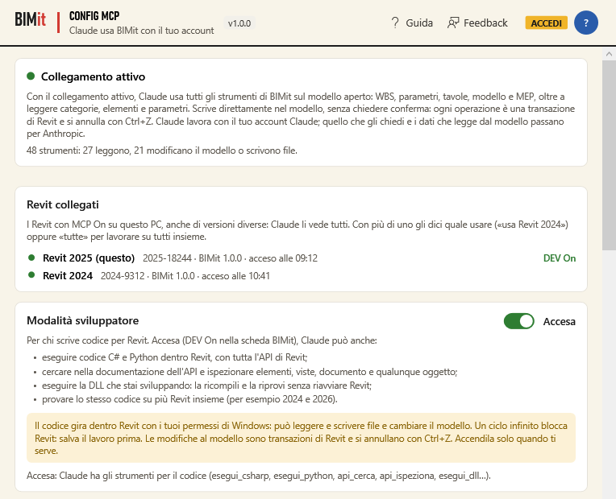

| Elemento | Cosa fa |
|---|---|
| **Collegamento attivo / non attivo** | Se Claude può usare BIMit in questo Revit adesso. Il collegamento è solo sul tuo computer e per il tuo utente, e si spegne quando chiudi Revit. Sotto, quanti strumenti vede Claude. |
| **Revit collegati** | I Revit con MCP On su questo PC: versione, identificativo (anno e numero del processo, per esempio *2025-18244*: è quello che Claude usa per sceglierli), versione di BIMit e ora di accensione. *(questo)* è il Revit da cui hai aperto la finestra. L'elenco si aggiorna da solo ogni pochi secondi. |
| **Collega Claude con un prompt · Copia prompt** | Il prompt di collegamento per Claude Code: il comando `claude mcp add` con l'indirizzo di BIMit su questo PC, l'autorizzazione dei suoi strumenti (`mcp__bimit`) e la voce per la chat di Claude Desktop. |
| **Aggiungi a Claude Desktop** | Aggiunge BIMit ai server MCP della chat di Claude Desktop, senza prompt. Il resto della configurazione di Claude non cambia (resta una copia del file precedente). |
| **Altri client MCP** | La configurazione JSON per gli altri client (Cursor, VS Code…), con **Copia**. |
| **MCP On / MCP Off** (in basso) | Come il pulsante della scheda. |
| **Ultime operazioni di Claude** | Ogni strumento che Claude ha usato: ora, nome, esito, durata. |

### Cosa può fare Claude

Gli stessi strumenti dei pulsanti, più alcuni per leggere il modello (in *corsivo* quelli che
modificano il modello o scrivono file):

| Gruppo | Strumenti |
|---|---|
| **Modello aperto** | modello_info, categorie, elementi, parametri_elemento, *imposta_parametri*, selezione, *seleziona*, viste, leggi_tabella (Excel o CSV, per esempio la tabella del committente) |
| **WBS** | wbs_guida, wbs_configurazione, *wbs_salva_configurazione*, wbs_anteprima, *wbs_scrivi*, wbs_valori, *wbs_dizionario_esporta*, *wbs_dizionario_carica* |
| **Esporta** | tavole_preset, *tavole_salva_preset*, *tavole_collega_preset*, tavole_profili, *tavole_profilo_salva*, *tavole_profilo_applica*, *tavole_profilo_elimina*, *tavole_profilo_rinomina*, *tavole_profili_importa*, *tavole_profilo_predefinito*, tavole_elenco, tavole_parametri, tavole_nomi_anteprima, *tavole_selezione_salva*, *tavole_selezione_elimina*, *tavole_imposta_elementi*, tavole_coda, *tavole_coda_modifica*, *tavole_esporta*, tavole_report, *tavole_elenco_elaborati*, *tavole_apri*, tavole_pianificazioni, *tavole_pianifica*, *tavole_pianificazione_gestisci* |
| **Parametri** | parametri_categorie_e_gruppi, parametri_condivisi_leggi, *parametri_condivisi_aggiungi*, parametri_progetto, *parametri_progetto_elimina*, *parametri_progetto_csv*, famiglie_elenco, famiglie_parametri, *famiglie_elimina_parametri* |
| **Modello** | sblocca_analizza, *sblocca*, livelli, sposta_livello_analizza, *sposta_livello*, esporta_per_ia_tabelle, *esporta_per_ia*, esporta_per_ia_leggi |
| **MEP** | mep_modelli, manicotti_opzioni, *manicotti_salva_opzioni*, manicotti_analizza, *manicotti_crea*, locali_spazi_analizza, *locali_spazi* |
| **Più Revit** | revit_istanze, revit_usa; con due o più Revit accesi ogni strumento ha anche l'argomento «revit» |

Ogni strumento accetta anche l'argomento facoltativo **«documento»**: il titolo, il nome del file o
il percorso completo di un documento aperto in quel Revit. Così Claude legge o modifica un modello
aperto senza che tu lo renda attivo; senza, usa il documento attivo.

### Più Revit insieme

Puoi accendere **MCP On** in più Revit aperti insieme, anche di versioni diverse (per esempio 2024
e 2026, o due 2025): Claude li vede tutti.

- **Quali sono** — *«quali Revit sono aperti?»*: Claude usa *revit_istanze*, che per ogni Revit dà
  l'identificativo (anno e numero del processo, per esempio `2025-18244`), le versioni di Revit e
  di BIMit e i documenti aperti.
- **Quale usare** — *«usa Revit 2024»* o *«lavora sul modello Ospedale»*: Claude usa *revit_usa*
  con l'identificativo, il numero del processo, l'anno (se c'è un solo Revit di quella versione) o
  il titolo di un documento aperto. Da lì in poi Claude lavora su quel Revit.
- **Per una sola richiesta** — con due o più Revit ogni strumento ha l'argomento facoltativo
  **«revit»**: Claude manda la richiesta a un Revit preciso senza cambiare quello scelto.
- **Tutti insieme** — con «revit» uguale a **«tutte»** lo strumento gira su ogni Revit e la
  risposta ha una sezione per ciascuno: *«in tutti i Revit aperti, quante porte ci sono?»*.
- Con un solo Revit acceso Claude usa quello. Con più Revit e nessuna scelta, Claude riceve
  l'elenco e sceglie, o ti chiede quale usare.

L'elenco è anche nella finestra *Config MCP*, in **Revit collegati**.

### Da sapere

- **Claude scrive direttamente nel modello**, senza chiedere conferma. Ogni operazione è una
  transazione di Revit: **Ctrl+Z** la annulla.
- Mentre è aperta una finestra di Revit o di BIMit che blocca Revit (una finestra di dialogo), Claude
  aspetta: chiudila e lui continua.
- Puoi collegare più Revit insieme (vedi *Più Revit insieme*). Dopo l'aggiornamento da BIMit 0.7
  riavvia Claude una volta: finché usa il collegamento della versione precedente vede un solo Revit.
- Quello che chiedi a Claude e i dati del modello che legge passano per **Anthropic**, con il tuo
  account (vedi l'[informativa privacy](PRIVACY.md)).
- Per la WBS Claude parte dalla configurazione collegata al modello, la stessa della finestra
  [WBS](#5-la-finestra-wbs): quello che salva lui lo ritrovi lì, e viceversa.

---

## 16. Account, Feedback, Aggiornamento

### Account

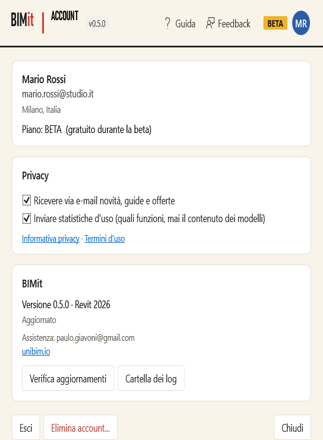

| Elemento | Cosa fa |
|---|---|
| **Nome, e-mail, città, piano** | I dati del tuo profilo. |
| **Ricevere via e-mail novità, guide e offerte** | Il consenso al marketing: lo dai o lo togli qui. |
| **Inviare statistiche d'uso** | Quali funzioni usi (mai il contenuto dei modelli). Toglila per non inviarle. |
| **Informativa privacy · Termini d'uso** | Aprono i testi. |
| **Versione · Revit** | Versione di BIMit e di Revit, e lo stato degli aggiornamenti. |
| **Verifica aggiornamenti** | Controlla adesso se c'è una nuova versione. |
| **Cartella dei log** | Apre la cartella del registro tecnico (utile all'assistenza). |
| **unibim.io** | Apre il sito. |
| **Esci** | Esce dall'account su questo PC. |
| **Elimina account…** | Cancella subito e per sempre account, profilo, statistiche e messaggi. Chiede conferma. |
| **Chiudi** | Chiude. |

### Feedback

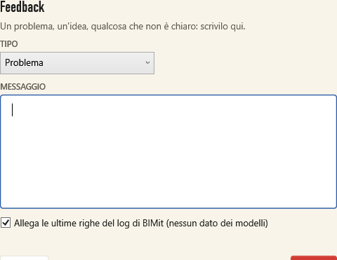

Scegli il **TIPO** (*Problema*, *Idea*, *Domanda*, *Altro*), scrivi il **MESSAGGIO** e premi **Invia**.
**Allega le ultime righe del log** aiuta a capire un errore: contiene solo dati tecnici di BIMit,
mai dei modelli.

### Aggiornamento

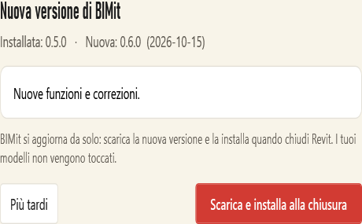

| Pulsante | Cosa fa |
|---|---|
| **Scarica e installa alla chiusura** | Di solito non serve: BIMit lo fa da solo all'avvio. Scarica la nuova versione, ne verifica l'integrità e la installa quando chiudi Revit. I modelli non vengono toccati. Se è già scaricata, la finestra lo dice. |
| **Più tardi** | Chiude. Se l'aggiornamento è già scaricato (*Aggiornamento pronto*) si installa comunque quando chiudi Revit; altrimenti BIMit riprova da solo al prossimo avvio. |

---

## 17. Domande frequenti

**Anteprima e Scrivi sono grigi.** Nessuna categoria inclusa, oppure la configurazione ha un errore:
leggi il messaggio in basso nella finestra WBS (passa il mouse per vederli tutti).

**Tutti gli elementi sono incompleti.** Apri l'*Anteprima* e guarda *Cosa correggere prima*: di
solito è un solo parametro (per esempio il numero di progetto vuoto o con il separatore, o livelli
con nomi non riconosciuti → *Tabella di conversione* del livello, *Suggerisci codici*).

**Un parametro «esiste come parametro di tipo/istanza: non verrà scritto».** Nel progetto c'è già un
parametro con quel nome ma con l'altro legame: in *Configura* cambia la casella *Parametro di tipo*
o usa un altro nome.

**L'aggiornamento non si installa.** Si installa quando si chiude **l'ultimo** Revit aperto sul PC
(anche di un'altra versione): chiudili tutti e riapri. Se vedi ancora la versione vecchia, in
*Account* premi *Verifica aggiornamenti* e manda un *Feedback* con il log allegato.

**Ho scritto e voglio tornare indietro.** Un solo **Ctrl+Z** in Revit annulla tutta la scrittura.

**Come passo la configurazione a un collega?** *Salva con nome…* e mandagli il file `.json`: lui lo
apre con *Apri…*.

**Il PDF o il DWG non si crea.** Il file con lo stesso nome è aperto (in un lettore PDF o in
AutoCAD): chiudilo e riprova. Il messaggio finale dice quale file non è riuscito.

**Il modello è di sola lettura.** BIMit mostra l'anteprima ma non scrive: apri il modello in
modifica (o crea il locale, se è condiviso).

**Assistenza** — pulsante **Feedback** in ogni finestra, oppure paulo.giavoni@gmail.com.

[Informativa privacy](PRIVACY.md) · [Termini d'uso](TERMS.md) · [Installazione](README.md)
